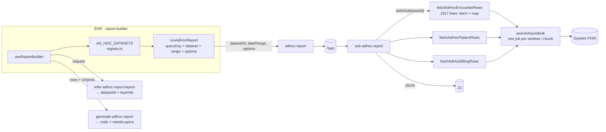
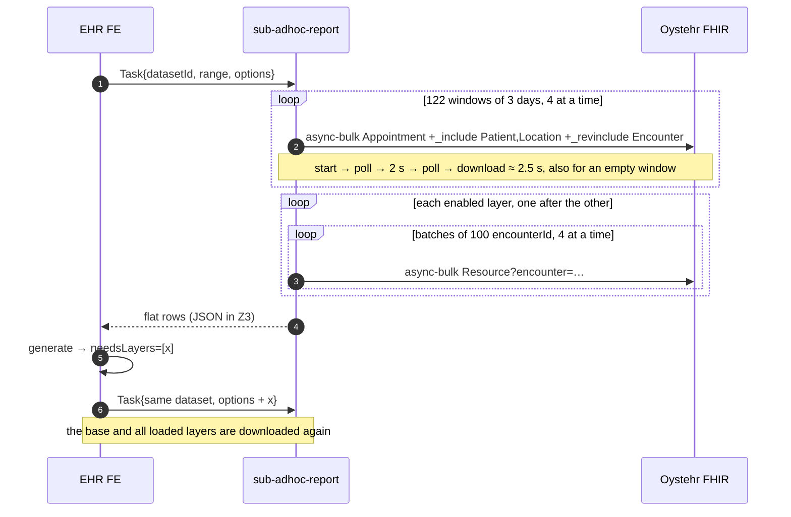
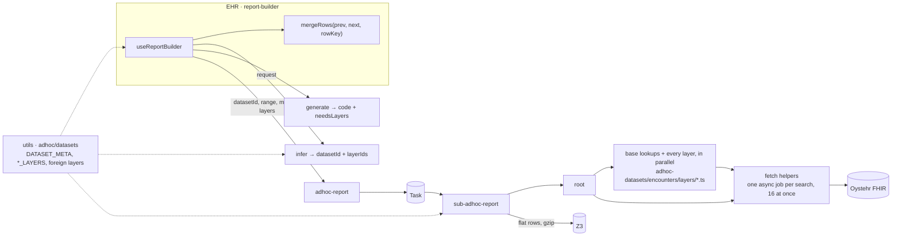
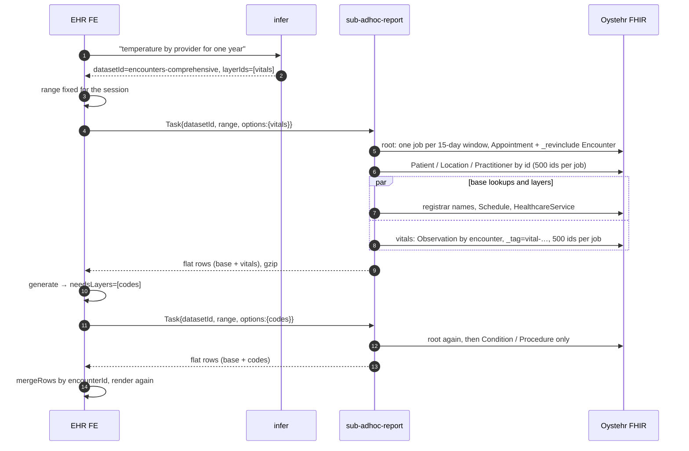
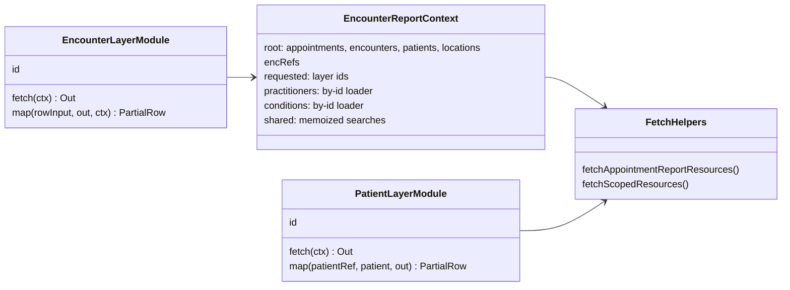
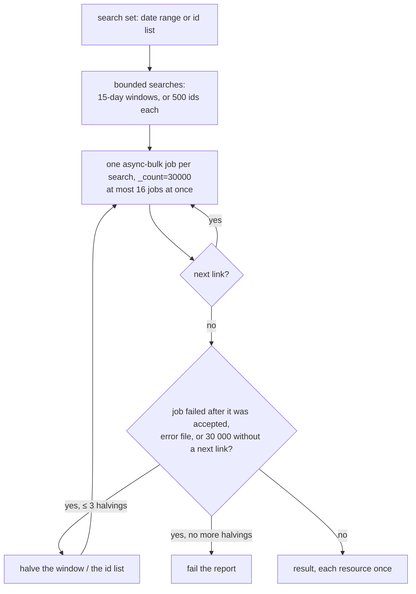
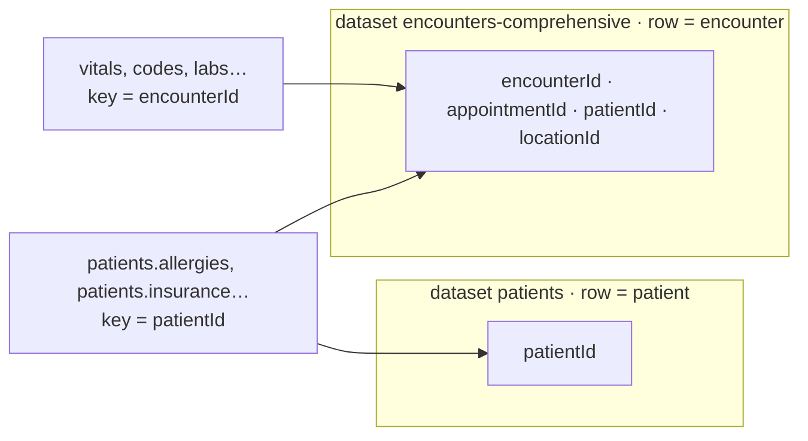

# Ad-hoc reports: layers instead of datasets — dev design

Repository: `local/core`. All paths are relative to it. Status: **prototype**, implemented 2026-11-11.
Numbers marked "(SC)" come from the document "Ad hoc reports: speed and completeness" and are not re-measured. Other numbers are measured on `local` with the tools in section 6.

**Summary**

- **Stays as is:** the Task transport, the saved report format (`datasetId` + `criteria.options`), the LLM generation, the start input, the output (flat rows), and the names: dataset, layer, `ENCOUNTER_LAYERS`, `AdHocLayerDef`, `fetchAppointmentReportResources`, `fetchScopedResources`. Report code gets the same flat rows as before.
- **Changes:**
  - every FHIR search runs as **one async-bulk job per bounded search** (a 15-day window or 500 ids), 16 jobs at once, with a split rule that never returns a part of the data;
  - the monolithic `fetchAdHocEncounterRows` / `fetchAdHocPatientRows` became **one module per layer**; the worker loads root, then all requested layers in parallel;
  - the front end loads **only the missing layers** and merges them into the rows it has;
  - a layer is bound to a **base field** (`encounterId`, `patientId`), not to a dataset, so the patients dataset's layers are also offered on the encounters and billing rows (`patients.allergies`, …);
  - the report data is stored gzip.
- **Result on local:** the encounters dataset with 5 layers loads 5× faster over 60 days with identical rows; a year (~43 500 visits) takes ~100 s, where the old code did not finish within the 13-minute budget. Settings may need tuning on production data (section 7).
- **Difference from Report Studio:** the fetch mechanics are the same kind (bounded searches, parallel jobs, split rules). The layer code decides what to fetch, not an LLM plan, so there are no server-side value filters and no count-only steps.

---

## 1. Before

### 1.1 Components



### 1.2 Execution (one year, encounters dataset)



### 1.3 Problems

| # | What | Cost |
|---|---|---|
| 1 | The base search is cut into windows of 3 days, one async-bulk job each, 4 at a time | ~2.5 s per job; one year ≈ 93 s (SC) |
| 2 | Each window returns Patient and Location in full; the same Patient comes back from many windows | extra MB per report |
| 3 | Layers load one after the other with `await`, though they do not depend on each other | time = sum of all layers |
| 4 | Search by id list: batches of 100, one job each, 4 at a time | hundreds of jobs per layer for a year |
| 5 | All Observations of a visit load for the vitals layer | over-fetch |
| 6 | A result of exactly 30 000 without a next link is not detected | data lost without an error |
| 7 | `needsLayers` downloads the full dataset again | ×2 time per generation |
| 8 | A layer is a flag with its logic in two places of one 1 917-line file; dependencies are implicit | a new or changed layer is expensive |
| 9 | One dataset per report; a cross-dataset request is rejected | "visits + allergies" is impossible |
| 10 | After the layers, three more searches run one after the other (registrar names, schedules, groups) | seconds on every report |
| 11 | The output JSON is not compressed | 4.5–13 s of download on large reports (SC) |
| 12 | A dropped connection fails the whole report: no retry | a year often failed on local |

---

## 2. Design

### 2.1 Principles

1. A **layer** is one module: `fetch` + `map` in one file. Searches several layers need, and by-id lookups, are memoized functions in the report context.
2. A **dataset** stays the row type of the result (encounter, patient, …) and keeps its id.
3. No layer calls FHIR directly. All searches go through the two fetch helpers in `shared/adhoc-report.ts`, which own the search size, the job pool, the next link and the split rule.
4. The output stays **flat rows**. The server glues the layers into rows. The report code contract does not change.
5. The front end requests only the **missing layers** and merges them into its rows by the row key.

### 2.2 Components



The billing-app datasets (`billing-claims`, `billing-rules`) are unchanged apart from gzip; the clinical/billing boundary from `PLAN-adhoc-billing-datasets.md` stays.

### 2.3 Execution



Run order in the worker (`adhoc-datasets/encounters/index.ts`):

1. **Root** (`root.ts`): appointments with their encounters (and follow-ups through `Encounter:part-of`), then patients, locations and the attending / intake practitioners by id.
2. **In parallel:** the base lookups (registrar names, location schedules, provider groups), every requested layer's `fetch`, and the requested foreign patient layers. Each needs only the root; the job pool limits the requests, not the layers.
3. **Rows:** one per encounter — the base row, then each layer's `map`, then the foreign columns by `patientId`.
4. A log line shows where the time went: `[adhoc] encounters timing: rows=… root ms=… layers ms=… map ms=… | <layer>: fetch … map …`.

There is no dependency graph: no layer depends on another layer. A layer needs the root and, at most, a shared search or a by-id loader.

### 2.4 Layer modules and the report context



- **Encounter layers:** `shared/adhoc-datasets/encounters/layers/*.ts`, 20 modules, one per id in `ENCOUNTER_LAYERS`. `map` gets the row's encounter, appointment, patient, attending practitioner, follow-up flag, visit status and status history.
- **Shared searches** (`context.ts`, each runs once per report, on first use): diagnoses, procedures, document references, service requests, medication administrations, all Observations, encounter conditions, intake paperwork, lab / nursing orders.
- **By-id loaders** (`memo.ts`): practitioners and conditions. An id is requested once per report, whoever asks.
- **Vitals** search Observations by the vital tags only, unless `examRos` or `intake` is loaded too; then the three read one untagged search.
- **Patient layers:** `shared/adhoc-datasets/patients/layers.ts`, 12 modules, keyed by patient. The account picture is loaded once for the contacts, insurance, eligibility and employers layers. `fetchPatientLayerColumns` gives the columns of any of them for any patients — the patients dataset and the foreign layers use it.
- **Billing dataset:** still one function; its independent layers now load in parallel.

### 2.5 Fetch helpers

Every search runs as an **async-bulk job** (start → poll every 1 s → download), with `_count=30000`.



| Limit | How the helpers handle it |
|---|---|
| A job without `_count` returns 1 000 resources (OTR-3686) | every job sends `_count=30000` |
| One result page holds 30 000 resources | follow the manifest's next link (OYST-3505); 30 000 without a link → halve the search |
| One query may run 30 s in the database | bounded searches; a job that fails after it was accepted is halved. On local the 30 s limit answered **400 with no body**, not 500, so any status counts |
| A bad request | refused when the job is started; not split, the report fails with the message |
| A 5xx, timeout or dropped connection when the job is started or downloaded | halved and run again |
| Halvings run out | the report fails; a part of the data is never returned |

- Constants (`adhoc-report.ts`): `DEFAULT_WINDOW_DAYS = 15`, `IDS_PER_ENTRY = 500`, `JOBS_IN_PARALLEL = 16`, 3 halvings. `ADHOC_IDS_PER_SEARCH` and `ADHOC_JOBS_IN_PARALLEL` override the last two for tuning runs (bench, local server).
- The pool counts jobs: one job, from start to download, holds one slot. A job waits for nothing else in the pool, so it cannot deadlock; halvings and next links run after the slot is free.
- Patients and locations are loaded by the ids in the appointments, once per report, not as an `_include` in every window.

### 2.6 Contracts

```ts
// utils/lib/types/adhoc/datasets/dataset.ts — AdHocLayerDef gets one optional field
interface AdHocLayerDef {
  label: string; description: string; default?: boolean;
  key?: string;   // the base field the layer is keyed by; omitted on a dataset's own layers (its row key)
  schema: z.ZodObject<z.ZodRawShape>;
}
// Another dataset's layers on this one: `<sourceId>.<layerId>`, only the fields this dataset does not have.
function foreignLayers(params: { sourceId; sourceLabel; source; key; base; native }): AdHocLayerMap;

// utils/lib/types/adhoc/datasets/meta.ts
const DATASET_META: Record<string, { rowKey: string; baseSchema: ZodObject; layers: AdHocLayerMap }>;
function layersForDataset(datasetId: string): AdHocLayerMap;   // own + foreign layers

// encounters.ts / billing.ts
ENCOUNTER_FOREIGN_LAYERS, ENCOUNTER_ALL_LAYERS   // patients.* on encounter rows, by patientId
BILLING_FOREIGN_LAYERS, BILLING_ALL_LAYERS       // patients.* on visit-payment rows, by patientId

// adhoc-report start input: NO CHANGE — options = the layers the caller does not have yet
//   (a foreign layer's flag is `includePatients.allergies`)
// Task output: NO CHANGE — flat rows; stored gzip
// infer: NO CHANGE in shape; the prompt says a foreign layer covers the other dataset's facts
// generate: NO CHANGE — needsLayers stays
```

- `encounterId` is required on the encounters and billing rows: it is the merge key.
- Foreign layer ids carry the dataset prefix, so they never collide with a dataset's own ids (`medications` exists in encounters and in patients) and old saved reports never contain them.
- Runtime validation is unchanged: the worker parses its input and validates its output with the Zod schemas built from the same layer maps the LLM sees.

Front end (`report-builder/page/useReportBuilder.ts`, `query/merge-rows.ts`, `query/dataset-query.ts`):

- The range is fixed for the session (same dataset and date controls). A range "until now" would gain visits every minute and change the row set between two loads. An explicit fetch starts a new session.
- `mergeRows(prev, next, rowKey)`: each row of `next` (base + the new layers) gets the fields of the `prev` row with the same key. When the two are not the same set of rows, every layer is loaded again.
- The data file is inflated in the browser (`DecompressionStream`); a plain JSON file from an older Task still reads.
- The Task status is polled after 500 ms, then every second.

### 2.7 Any data, not one dataset



| Report | Before | Now |
|---|---|---|
| Visits + patient allergies | rejected (two datasets) | encounters + `patients.allergies` |
| Visit payments + patient language | rejected | billing + `patients.demographics` |
| Patients + diagnoses of their visits | `visitHistory` only | unchanged (no "many" layers) |
| Visits + claim status (billing app) | rejected | unchanged: out of scope (clinical/billing boundary) |
| Two independent tables in one report | no | unchanged: it would change the report code contract |

"Any data" means data with a layer module; each new kind of data is one new module.

### 2.8 Compatibility

| What | How |
|---|---|
| Saved reports | No change: `datasetId` and `criteria.options` keep their meaning |
| Report code (JSX) | No change: same flat rows, same schema |
| Rows | The fixture tests pass unchanged; the bench compare shows identical rows against the old code (section 6) |
| System reports / Report Studio | Not affected |

---

## 3. What was learned on the way

- **A batch Bundle as one async job loses data.** The first plan put many searches into one batch job to pay the job cost once. Measured on local: every search inside it stopped at exactly 1 000 resources (two 15-day windows → exactly 2 000 appointments, five jobs in a row), and a by-id search with more than 1 000 matches came back empty (batch 0, the same search alone 1 054) — with no error, no error file and no next link. The output does not say which search returned what, so the loss cannot be detected. Dropped: one job per search.
- **The Appointment count for a year timed out at 14 s.** It was only meant to size the windows; fixed 15-day windows are far under one page. Dropped.
- **The database's 30 s limit answers 400 with no body**, not 500. The split rule now treats any failure of an accepted job as "did not finish".
- **Time is mostly the fixed cost per job**, not data and not mapping (mapping a year: ~1.5 s). Fewer, larger searches and more jobs at once are what helps.

## 4. Risks and open questions

- **Production-like data.** `local` has many visits and few clinical records per visit. On real data a 500-id search carries far more records and may reach the 30 s limit: it then splits (slower, still complete). Run the bench there and watch for `split` / `FAILED` lines; lower `ADHOC_IDS_PER_SEARCH` if splits are frequent.
- **Load on the Oystehr project.** 16 jobs per report; several reports at once multiply that.
- **Dangling references in the data.** A medication order whose patient is not among the loaded patients is skipped by the app's order mapper, as before; on local this logs one stack trace per order.
- **The LLM picks the dataset and layers.** The infer catalog is longer with the foreign layers; check it on the eval set.
- **Small reports** still pay the Task round-trip (~2 s); a direct call is not in this design.
- **Not covered:** the data kinds missing from the layer maps, billing-app layers on clinical rows, "many" layers, two tables in one report, server-side value filters and count-only steps (Report Studio has them).

## 5. Report Studio, for comparison

| | Layers (this design) | Report Studio (LLM plan + runner) |
|---|---|---|
| Fetch mechanics | bounded searches, parallel jobs, split rules | the same kind |
| Query shape | fixed, in the layer code | custom per report |
| Server-side value filters, count-only | no | yes |
| Data traps (empty dates, follow-up without `end`) | handled once in code | plan checks + data map |
| Report storage | no change | new model (`plan`, `inputs`) |
| New data kind | new module (code) | change in the data map |
| LLM errors in the fetch | not possible | possible |

## 6. Tools and measurements

All in `packages/zambdas`, read-only against Oystehr, `<env>` is a file in `config/.env` (e.g. `local`):

| Tool | What it does |
|---|---|
| `npm run adhoc-bench-compare -- <env> [days] [layers] [rounds]` | checks the old code out in a temporary worktree, runs the encounters fetch in both, alternately on the same range; prints the time of each and whether the rows are identical (and which columns differ). Both get network retries and no 13-minute budget; a run over the budget is flagged |
| `npx tsx src/scripts/adhoc-bench.ts <env> <start> <end> <layers> <out.json>` | the current code only: time, rows, settings used; the log has the `encounters timing` line |
| `npm run adhoc-bench-reports -- <env> [ranges] [reports]` | three typical reports fetched three ways (this version, ideal searches, Report Studio from a worktree of its branch); time, requests, errors, whether the result matches the ideal one, where the time went |
| `npm run adhoc-m0-spike -- <env> [days]` | compares each root window and a by-id search with an exact count; prints `MISSING` on any loss |

Comparison of this version with hand-written ideal searches and Report Studio on three typical reports: [adhoc-bench-reports.md](adhoc-bench-reports.md).

Measured on local (encounters dataset with codes, vitals, medications, labs, signing; server-side fetch only):

| Data | Old code | New code |
|---|---|---|
| 60 days, 1 119 visits | 106 s | 21 s (5×), rows identical |
| a year, ~43 500 visits | did not finish (13-minute budget; dropped connections) | 336 s at 250 ids / 8 jobs, 185 s at 500 / 8, **101 s at 500 / 16**, no splits |

## 7. Rejected options

| Option | Why not |
|---|---|
| Batch Bundle as one async-bulk job | measured: each search in it stops at 1 000 or comes back empty, without an error (section 3) |
| Window size from an Appointment count | measured: the count for a year timed out at 14 s; fixed windows suffice |
| Planner with stages, Executor, Strategy classes, a Catalog object | the same work in more code; no layer depends on another layer |
| Time-based split of a job that is still running | not deterministic: a cold cache is 3–5× slower (SC) |
| Sync search by id | the 14 s and 6 MiB limits of a sync call |
| Direct zambda call for small reports (no Task) | a second transport with a 27 s cap |
| Server snapshot of the root keys | not needed once the range is fixed per session |
| Rename dataset → grain; infer by fields | no user value; the old names are in the prompts, saved reports and code |
| "Many" layers, automatic key bridges, billing sub-requests | more code per layer; breaks the clinical/billing boundary |
| `Group/$export`, `async-bundle` mode | no date filter and full compartments; the 1 000 / 6 MiB page limits stay |
