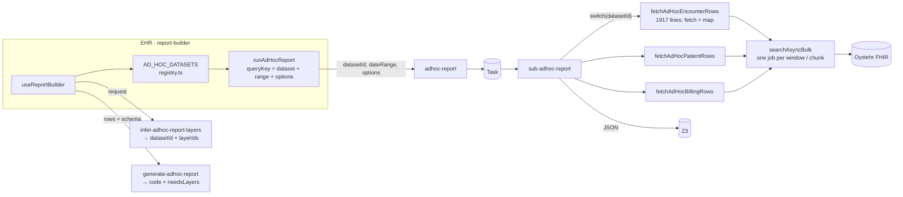
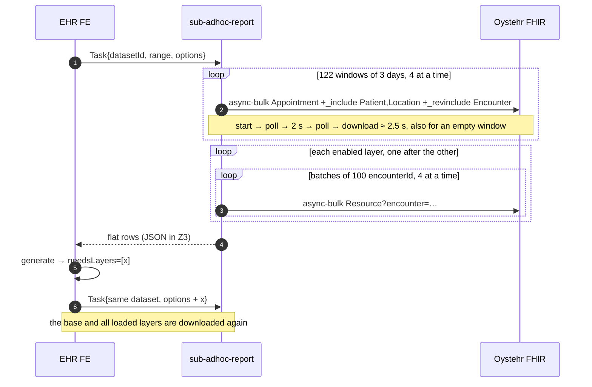
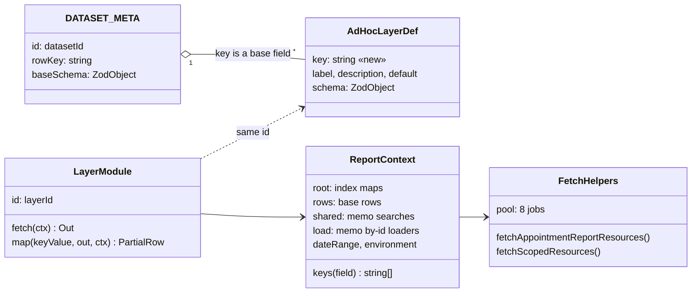
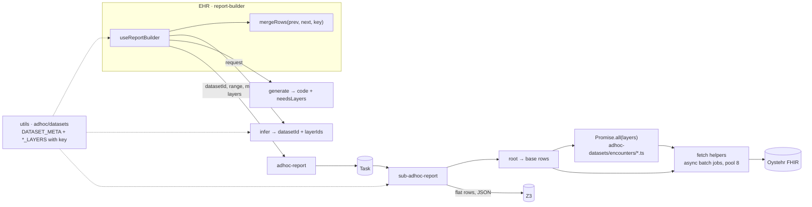
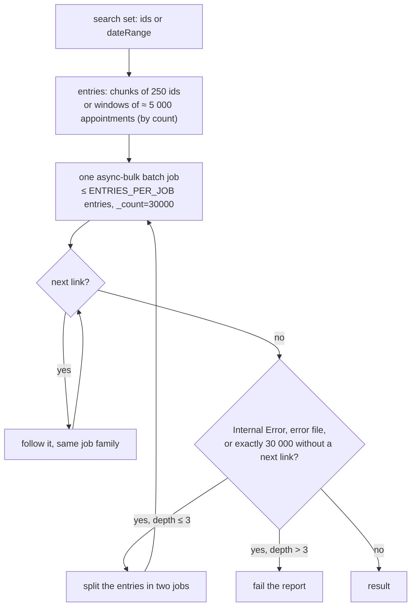
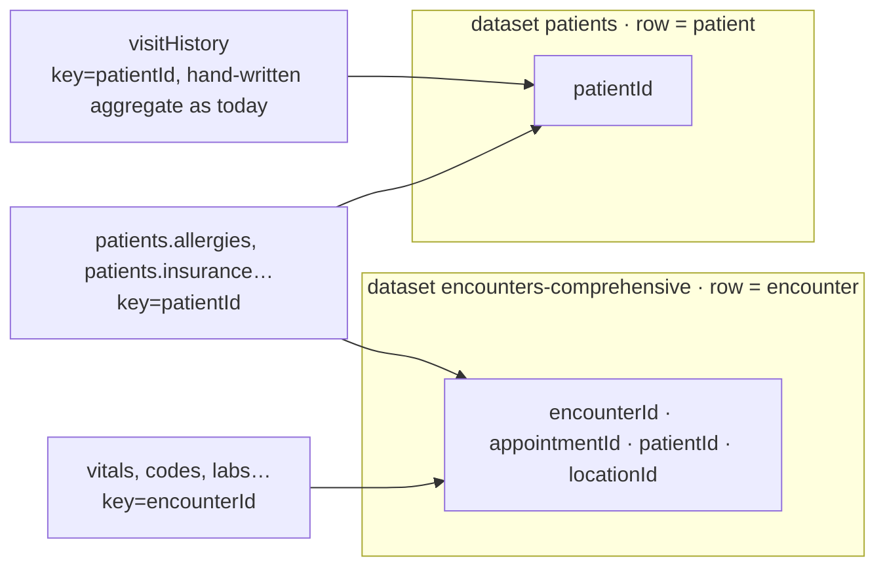

# Ad-hoc reports: layers instead of datasets — dev design

Repository: `local/core`. All paths are relative to it. Status: prototype, implemented 2026-11-11 (see section 8).
Numbers marked "(SC)" come from the document "Ad hoc reports: speed and completeness". They are not re-measured. Numbers marked "(estimate)" are calculated, not measured.

**Summary**

- **Stays as is:** the Task transport, the saved report format (`datasetId` + `criteria.options`), the LLM generation, the start input, the output (flat rows), and the names: dataset, layer, `ENCOUNTER_LAYERS`, `AdHocLayerDef`, `fetchAppointmentReportResources`, `fetchScopedResources`. Report code gets the same flat rows as today.
- **Changes:** the fetch helpers run one **async batch job** per search set instead of many jobs. This is the only fetch path: no fallback to per-window jobs, no sync search by id. A one-day spike (M0) confirms the Oystehr limits before the code is written. The output is gzip. The monolithic `fetchAdHoc*Rows` functions become one module per layer, moved one at a time. The worker runs root, then all requested layers in parallel. The front end requests only the missing layers and merges the rows by key. A layer is bound to a **base field** (`encounterId`, `patientId`, …), not to a dataset, so one report can use layers from different datasets.
- **No graph, no new classes.** Each layer depends on root and, at most, on a shared search or a by-id loader. Both are memoized functions in a context object.
- **Difference from Report Studio:** the fetch mechanics are the same, so the speed is comparable. The layer code decides what to fetch and how, not an LLM plan. We do not get server-side value filters and count-only steps.

---

## 1. Today

### 1.1 Components



### 1.2 Execution (one year, dataset encounters)



### 1.3 Problems

| # | Where | What | Cost |
|---|---|---|---|
| 1 | `shared/adhoc-report.ts:306` | The base search is cut into windows of 3 days. Each window is one async-bulk job, 4 at a time | ~2.5 s per window; one year ≈ 93 s (SC) |
| 2 | `adhoc-report.ts:337` | Each window returns Patient, Location and Encounter in full. The same Patient comes back from many windows | extra MB per report; Patients by id for a year: 2.4 s against 15.3 s (SC) |
| 3 | `adhoc-datasets/encounters.ts:488–831` | Layers load one after the other with `await`. They do not depend on each other | time = sum of all layers |
| 4 | `adhoc-report.ts:440` | Search by id list: batches of 100, one async-bulk job each, 4 at a time | ~32k visits → ~320 jobs per layer ≈ 3–4 min (estimate) |
| 5 | `encounters.ts:611` and others | All Observations of a visit load without `_tag` or `_elements` | over-fetch |
| 6 | `adhoc-report.ts:291` | No check for "exactly 30 000 returned → split". Only the next link (OYST-3505) is handled, and the server does not send it yet | data is lost without an error |
| 7 | `useReportBuilder.ts:414`, `datasets/encounters.ts` queryKey | `needsLayers` downloads the full dataset again | ×2 time per generation |
| 8 | `encounters.ts` | Each layer is one flag. Its logic is in two places (fetch and map). Dependencies are implicit (`includeCodes \|\| includeProcedures`) | a new layer or a change of a layer is expensive |
| 9 | registry + infer | The dataset is chosen first. A change of dataset is a full reload. A cross-dataset report is rejected | UX, extra fetches |
| 10 | `encounters.ts:837–874` | After the layers, each report runs three more searches one after the other: `getStaffNameByEmail` (`user.list()`, then Practitioner in batches of 80, also one after the other), Schedule by location, HealthcareService by id | several seconds on every report |
| 11 | `sub-adhoc-report`, Z3 | The output JSON is not compressed | 4.5–13 s of download on large reports (SC) |

---

## 2. Target

### 2.1 Principles

1. A **layer** is one module: `fetch` + `map` in one file. Shared searches and by-id loaders are memoized functions in the report context.
2. A **dataset** stays the row type of the result (encounter, patient, …) and keeps its id. The user does not select it in stage 3; infer does.
3. No layer calls FHIR directly. All requests go through the two fetch helpers in `shared/adhoc-report.ts`. They own the batch jobs, the entry size (windows by count, 250 ids), the next link, the split on `Internal Error`, and the one shared pool.
4. The output stays **flat rows**. The server glues the layers into rows, as today. The report code contract does not change.
5. The front end requests only the **missing layers**. It merges the new rows into the rows it already has, by key.

### 2.2 Model



- `DATASET_META` (new, small) and `ENCOUNTER_LAYERS` / `PATIENT_LAYERS` / … (today's maps, plus `key`) live in `utils`. The front end, infer and the worker read them. They have no fetch code.
- `LayerModule` lives in `zambdas`, in `shared/adhoc-datasets/<dataset>/<layer>.ts`. Its `fetch` reads the root resources and the memoized functions from the context.
- `ctx.shared` holds only searches that are the same for all callers: `serviceRequests()` for `labs`, `disposition`, `nursing`, `procedures`; `medicationAdministrations()` for `medications`, `immunizations`. Observation is not shared: `vitals`, `examRos` and `intake` each search with their own `_tag` list. Two small searches cost about the same as one large one, and a memo function cannot take a tag list and stay a memo.
- `ctx.load` holds by-id loaders: `patients(ids)`, `locations(ids)`, `practitioners(ids)`, `conditions(ids)`. A loader removes duplicate ids across all callers and sends one batch job.

### 2.3 Components



The billing-app datasets (`billing-claims`, `billing-rules`) run in `sub-adhoc-billing-dataset` with the same runner and fetch helpers from shared code. The clinical/billing boundary from `PLAN-adhoc-billing-datasets.md` does not change.

### 2.4 Execution

```mermaid
sequenceDiagram
  autonumber
  participant FE as EHR FE
  participant I as infer
  participant W as sub-adhoc-report
  participant F as Oystehr FHIR
  FE->>I: "temperature by provider for one year"
  I-->>FE: datasetId=encounters-comprehensive, layerIds=[vitals]
  FE->>FE: no rows yet; dateRange.end is fixed for the session
  FE->>W: Task{datasetId, range, options:{vitals}}
  W->>F: root: one Appointment count, then one async batch job; entries = windows of ≈ 5 000 appointments, Appointment + _revinclude Encounter
  W->>F: load.patients / load.locations / load.practitioners: one batch job each, by id, _elements
  W->>W: base rows
  W->>F: vitals: one async batch job, 128 entries × 250 encounterId, Observation _tag=vital-temperature,vital-heartbeat,…
  W->>F: load.practitioners(authorIds): new ids only
  W-->>FE: flat rows (base + vitals)
  FE->>FE: generate → needsLayers=[codes]
  FE->>W: Task{datasetId, range, options:{codes}}
  W->>F: root again (one job), then Condition / Procedure only
  W-->>FE: flat rows (base + codes)
  FE->>FE: mergeRows by encounterId, render again
```

### 2.5 Run order

The worker does four steps:

1. `root(ctx)`: Appointment + `_revinclude` Encounter (+ `_revinclude:iterate` Encounter:part-of) for the range. Then, in one `Promise.all`: `ctx.load.patients`, `ctx.load.locations`, `ctx.load.practitioners` by the ids in those resources (with `_elements`), `ctx.load.schedules` by location, `ctx.load.healthcareServices` by id, and `ctx.shared.staffNames()`. This closes problems 2 and 10: no `_include` of Patient and Location per window, and no serial tail after the layers.
2. Base rows from root. `ctx.rows` and `ctx.keys(field)` are ready after this step.
3. `Promise.all(requestedLayers.map((l) => l.fetch(ctx)))`. Each layer starts at once. The pool limits the jobs, not the layers.
4. For each base row: `row = { ...base, ...layer.map(row[layer.key], out, ctx) }` for each layer.

There is no dependency graph. `encounters.ts` has no layer-to-layer chain. Each layer needs root and, at most, a shared search or a loader.

Note: FHIR `_tag` has no wildcard. "vital-*" in this document means the full comma list of the vital tag codes (`vital-temperature,vital-heartbeat,vital-blood-pressure,…`).

### 2.6 Fetch helpers

> **Changed after M0 (2026-11-10).** The batch-job path below was measured and dropped. On `local`, 365 days: every search inside a batch job stopped at exactly 1 000 resources (two 15-day windows → exactly 2 000 appointments, five jobs in a row), and a by-id search with more than 1 000 matches came back empty (batch 0, the same search alone 1 054) — no error, no error file, no next link. A batch job's output does not say which search returned what, so the loss cannot be detected. The fetch helpers now run **one async-bulk job per search** with `_count=30000`, as the reports did before: 15-day windows, 500 ids per search, 16 jobs at once (tuned on local, see section 8), the same split / next-link / 30 000 rules (now exact: a job is one search). The Appointment count is dropped too: for a year it timed out at 14 s, and fixed 15-day windows are far under one page. The text below is kept as the design record.

Oystehr runs a **batch Bundle as one async job** (`oystehr.fhir.batch({ requests }, { mode: 'async-bulk' })`, SDK 4.3.15). The job output is NDJSON, grouped by resource type across all entries. The SDK adds the `_tag:not` scoping to each search entry. One job replaces a group of jobs: 128 chunks of ids, or the windows of a year, go into one request. This is the only fetch path. There is no plan B and no fallback to the old per-window jobs.

**Why entries still exist.** The async job removes the limit on what the server may *send*. It does not remove the limit on what one query may *run*: each search entry is one database query behind the API, and a query that runs too long fails with `Internal Error` (see the comment at `adhoc-report.ts:305`). So one entry must stay a bounded query: one window of ≈ 5 000 appointments, or 250 ids. The entries are not windows for the client; they are the unit of work for the server. In the diagrams, "window" means that.



Three limits, three answers:

| Limit | Where it comes from | How the helper handles it |
|---|---|---|
| Query run time | one entry = one database query through the API; a long query ends with `Internal Error` | bound each entry: windows sized by count, 250 ids per chunk. On `Internal Error`, split the job's entries in two and run again, up to 3 levels, then throw |
| 30 000 resources per job result | the async-bulk page size | `_count=30000` and the `next` link in the manifest (`adhoc-report.ts:268`, test `adhoc-async-bulk-next-link.test.ts`). Oystehr now sends the link (OYST-3505); M0 confirms it also for a batch job. Exactly 30 000 without a link = the guard for problem 6: split, then throw |
| Request size | the batch Bundle is one POST | 40 entries × 250 ids ≈ 0.4 MB, far under 6 MiB. `ENTRIES_PER_JOB` keeps it so |

- `fetchAppointmentReportResources(dateRange)`: entries = windows (`reportWindows`). `fetchScopedResources(type, param, ids)`: entries = chunks of 250 ids. The signatures stay. Only the inside changes.
- **Window size by record count.** For a range over 30 days, root first runs one `Appointment` count for the range (`_summary=count`, ~0.5 s). The window size is then `range × 5000 / count` days. If the count fails or is 0, the window size is 15 days. The count changes only the partition, never the data. Known count bugs (`_summary=count` reports 1 on an empty project; QuestionnaireResponse count is wrong) do not touch an Appointment count.
- `ENTRIES_PER_JOB` starts at 40 (≈ 10 000 ids). A full year of visits is then 1 root job and 4 jobs per layer, against 25 and 128 jobs with one search per job.
- The 30 000 check counts all resources in the output, with the `_include` / `_revinclude` ones (SC: the limit applies to them too). The job's `error` files count as a failure.
- The split never returns a part of the data. After 3 levels (a job with 1 entry that still fails) the helper **throws**. Else problem 6 comes back.
- No time-based split. The first run on a cold cache is 3–5 times slower (SC), so a timer would split at random. The report budget (13 min) stops a hang.
- `JOBS_IN_PARALLEL = 4` per report, `p-limit`. **One job, from start to download, is one slot.** A job has no child tasks inside, so there is no deadlock. With batch jobs a report has 1–6 jobs, so the pool is small; it exists because Oystehr may limit the async jobs of one project. Loaders and layer code stay outside the pool.
- `_offset` paging inside a job gets slower with each page (`_offset=60000` scans past 60 000 rows). The count-based window size keeps a root job under one page in the normal case; the next link is for the long tail.
- Rejected: `async-bundle` mode (keeps 1 000 per page and 6 MiB); `Group/$export` (full patient compartment, no date filter, needs a Group); sync `POST /_search` by id (the 14 s and 6 MiB limits of a sync call come back); a paged-search path for short ranges (see section 7).

**M0 confirms, it does not choose.** Stage 0 starts with a one-day spike on throwaway code. It answers: does a batch job send the next link; is the 30 000 limit per job or per entry; does an entry take its own `_count`; how many entries one job runs before `Internal Error`; how long one job with 40 entries runs against 40 single jobs. The constants above (40 entries, 5 000 per window, 250 ids, 4 jobs) are start values; M0 sets them. If a batch job turns out broken on the Oystehr side, that is a bug report to Oystehr and a stop of stage 0, not a second code path here.

### 2.7 Contracts

```ts
// utils/lib/types/adhoc/datasets/*  (no fetch code here)
// DATASET_META is new. *_LAYERS are today's maps; AdHocLayerDef gets one field.
const DATASET_META: Record<string, { rowKey: string; baseSchema: z.ZodObject<z.ZodRawShape> }> = {
  'encounters-comprehensive': { rowKey: 'encounterId', baseSchema: EncounterBaseRowSchema },
  patients: { rowKey: 'patientId', baseSchema: PatientBaseRowSchema },
  // billing, billing-claims, billing-rules
};
interface AdHocLayerDef {
  key: string;                       // NEW: a field name of the base row, e.g. 'encounterId' | 'patientId'
  label: string; description: string; default?: boolean;
  schema: z.ZodObject<z.ZodRawShape>;
}
// A layer is available to a dataset when its baseSchema has the field layer.key.
// Native layers keep their ids. Foreign layers get the dataset prefix: 'patients.allergies'.
function layersForDataset(datasetId: string): AdHocLayerMap;   // next to layerOptions, unloadedLayers

// zambdas/src/shared/adhoc-datasets/<dataset>/<layer>.ts  (fetch code here)
interface LayerModule<Out> {
  id: string;
  fetch(ctx: ReportContext): Promise<Out>;
  map(keyValue: string, out: Out, ctx: ReportContext): Partial<Row>;
}
interface ReportContext {
  oystehr: Oystehr; dateRange: DateRange; environment: string;
  root: { encounterById: Map<...>; appointmentMap: Map<...>; /* as today */ };
  rows: BaseRow[];
  keys(field: string): string[];               // distinct values of a base field, e.g. keys('patientId')
  shared: { serviceRequests(): Promise<ServiceRequest[]>; medicationAdministrations(): Promise<...> };
  load: { patients(ids): Promise<Map<string, Patient>>; practitioners(ids): ...; conditions(ids): ... };
}

// adhoc-report start: NO CHANGE. options = the layers the caller does not have yet.
interface StartInput { datasetId: string; dateRange: DateRange; options?: Record<string, boolean> }
// Task output: NO CHANGE. Flat rows: base + the requested layers.
// infer: NO CHANGE. The catalog for a dataset lists layersForDataset(id), so it includes foreign layers.
// generate: NO CHANGE. needsLayers stays.
```

Rules for the row key and the layer ids:

- `encounterId` becomes required in `EncounterBaseRowSchema` (today `encounters.ts:91` has it optional). Each row comes from an Encounter resource, so the value always exists. Rows merge by `encounterId`, not by `appointmentId`: a follow-up annotation shares the parent's appointment.
- Layer ids collide across datasets: `medications` (encounters, patients), `eligibility` (patients, billing), `codes` (encounters, billing, billing-claims). Saved reports store `options` by id inside one dataset. So a dataset's own layers keep their ids. A foreign layer gets the dataset prefix: `patients.medications` on the encounters dataset.
- Fields collide too: `city`, `zip`, `email`, `dateOfBirth` are in the encounters base and in `patients.demographics`. A foreign layer contributes only the fields that are not in the dataset's base schema and not in a native layer. The catalog and the `map` output drop the rest.

Front end (`report-builder/query`, `useReportBuilder.ts`):

- The session fixes `dateRange.end` at the first load. Without that, a range "until now" gets new visits each minute (~91 per day on practice B), and the row set changes on each delta.
- `mergeRows(prev, next, key)`: for each row in `next`, add the fields from the row in `prev` with the same key. About 15 lines. When the key sets differ (rows added or removed between two calls), drop `prev` and do a full load with all needed layers. With a fixed `end` this is rare.
- The react-query key becomes `dataset + range + requested layers`. The merged rows live in the hook state.
- The schema for `generate` comes from the merged rows and the union of loaded layers, as today.
- Delta works on the monolith too: `options = { codes: true }` makes `fetchAdHocEncounterRows` run root + codes, because the include flags already exist. So stage 2 does not wait for stage 1.

### 2.8 Compatibility

| What | How |
|---|---|
| Saved reports (`Basic saved-adhoc-report`) | No change. `datasetId` and `criteria.options` keep their meaning. Foreign layer ids are new, so old reports never contain them |
| Report code (JSX) | No change. Same flat rows, same schema |
| Rows | Golden tests for row equality: extend `adhoc-datasets-fixture`, `adhoc-*-extended-fixture` |
| System reports / Report Studio | Not affected. The fetch helpers can become their runner later |

### 2.9 Any data, not one dataset

A layer has a **key**: a base field name. A dataset can use a layer when its base schema has that field. No `provides` list, no automatic bridges. If the dataset has no such field, the layer is not in `layersForDataset`, and infer reports the concept as `unavailable`.



| Report | Today | Target |
|---|---|---|
| Visits + patient allergies | encounters and patients are different datasets, `multiDatasetRequest` rejects it | dataset `encounters-comprehensive` + layer `patients.allergies` |
| Patients + diagnoses of their visits | only through `visitHistory` | same: `visitHistory` stays a hand-written patient-keyed layer. A generic "many" cardinality is out of scope |
| Visits + claim status (billing app) | different apps, different datasets | out of scope. A sub-request from the clinical worker to the billing worker breaks the boundary in `PLAN-adhoc-billing-datasets.md` (correction 2) and needs a 32k-key transport |
| Two independent tables in one report | no | out of scope. It changes the report code contract |

Limits:

- "Any data" means data with a layer module. The 72 data kinds from the inventory need one module each.
- A patient-keyed layer on the encounters dataset fetches by `ctx.keys('patientId')`: one record per distinct patient, not per visit.
- For stage 3, the `patients` layer functions must be callable from the encounters worker. That is a move of functions, not a full stage 1.

---

## 3. Stages

Order: **0 → 2 → 3**. Stage 1 runs in parallel, one layer at a time, when a layer is touched. Stage 1 blocks nothing.

| Stage | What | Where | Contracts | Done when | Estimate |
|---|---|---|---|---|---|
| 0. Mechanics | M0 spike, then batch jobs with next link and split on `Internal Error` in `fetchAppointmentReportResources` / `fetchScopedResources` (2.6); window size by count; root without `_include` Patient/Location, loaders by id with `_elements`; staff names, Schedule and HealthcareService out of the serial tail (problem 10); `_tag` on the heavy searches; in the monoliths, two phases: all root-only searches in `Promise.all`, then the name and condition lookups; gzip of the output (~20 lines; the browser inflates with `DecompressionStream`) | `shared/adhoc-report.ts`, `adhoc-datasets/*`, `report-builder/query` | no change | rows are equal; M0–M3 times in the `[adhoc]` logs | 5–7 d |
| 2. Delta | fixed `dateRange.end` per session; `mergeRows`; `needsLayers` requests only the missing layers; Task poll at 500 ms, then every 1 s | `report-builder/query`, `useReportBuilder.ts` | no change | a second generation with a new layer downloads only that layer (plus root); M4 | 2–3 d |
| 3. Foreign layers | `key` on each layer; `DATASET_META`; `layersForDataset`; prefixed ids and field de-duplication; `patients` layer functions callable from the encounters worker; dataset selector hidden | `utils/.../adhoc/datasets`, infer catalog, `ReportBuilderPage` | no change | the 51-report eval set is not worse than today; M5 passes | ~1 wk |
| 1. Modules (gradual) | `ReportContext` with `shared` and `load`; each layer moves to `adhoc-datasets/<dataset>/<layer>.ts` when it is touched; golden tests per moved layer | `shared/adhoc-datasets/**` | no change | `encounters.ts` is deleted | 1.5–2 wk, spread |

All estimates are rough. Stage 0 gives most of the speed. It can ship alone.

Stage 0 detail: the blocks in `encounters.ts:488–831` share mutable maps. `practitionerMap` is filled by several blocks; `medicationOrderResources` copies `practitionerMap` at the call time (`:608`); `fetchEncounterOrders` gets the practitioners as an argument (`:826`). A plain `Promise.all` over the blocks makes the rows depend on the finish order. So stage 0 uses two phases: phase 1 runs all searches that need only root; phase 2 runs the name and condition lookups with the ids collected in phase 1.

## 4. Risks and open questions

- **Batch jobs are not measured yet.** M0 answers: next link on a batch job; 30 000 per job or per entry; `_count` per entry; entries per job before `Internal Error`; job time against single jobs; error files. If a batch job is broken on the Oystehr side, stage 0 stops and the finding goes to Oystehr. There is no plan B in this design: a second fetch path is more code to keep than the time it saves.
- **Report Studio parity.** On reports that need rows the two designs are about equal after stage 0 (estimate from SC: practice B, 60 days, 12–20 s here against 8–16 s; one year: equal on the id layers, equal on root with windows by count). Reports that need only totals stay 2–4× slower in relative terms, a few seconds in absolute terms (SC: 5.7 s against 23.6 s for a year today; root for a year becomes ~10 s here). That is the price of no LLM plan: no count-only steps, no server-side value filters, no field cuts per report.
- **Small reports and the Task round-trip.** A Task adds ~2–3 s to a report that takes 0.5 s (SC flowsheet: 0.5 s against 3.1 s). A direct zambda call for short ranges is not in this design: it is a second transport with its own 27 s cap, and a cold cache is 3–5× slower, so a direct call can fail where a Task would not. First do the cheap part in stage 2: poll the Task at 500 ms, then every 1 s, not every 2 s. Measure, then decide on a direct call as a separate item.
- **Row parity for 3.2k lines of map code.** Golden tests per layer before and after the move.
- **Thresholds** (250 ids, 5 000 appointments per window, 40 entries, 4 jobs) are measured on practice B only. Repeat on practice A before stage 0 ships.
- **`_elements` on root.** The base row reads many fields of Appointment and Encounter. In stage 0, use `_elements` only on the loaders (Patient, Location, Practitioner, Schedule) with a known field list. Add it to Appointment and Encounter in stage 1, when each layer declares what it reads.
- **Delta and data changes.** With a fixed `end`, the row set changes only when a visit is created or deleted inside the range after the first load. Then the front end does a full load. No snapshot store is needed.
- **The LLM picks the dataset.** A wrong dataset gives a wrong report. Infer must check that each field is in the dataset's base or in `layersForDataset(id)`. Else it returns `unavailable`, as today.
- **The infer catalog grows.** The encounters dataset gets 12 `patients.*` layers with their fields, so the prompt gets longer. The 51-report eval set in stage 3 must show no loss. If it does, send foreign layers to infer as names only, without fields.
- **Point fetches inside a layer.** A layer loads only when it is requested, but inside a layer the resources still come in full. `_tag` closes the worst case (Observation) in stage 0; `_elements` per layer comes with stage 1.
- **Not solved:** the 72 data kinds from the inventory. Each one is a new module, one file, not a change in a monolith. Billing-app layers on clinical datasets, "many" layers and two tables in one report stay out of scope.

## 5. Measurements (minimum set)

| # | Prompt | Expected dataset / layers | What it measures | Ranges |
|---|---|---|---|---|
| M0 | saved report from M2 | encounters + vitals | spike, throwaway code: one batch job with 40 entries against 40 single jobs 8 at a time; next link on a batch job; 30 000 per job or per entry; `_count` per entry; entries per job before `Internal Error`; error files. Sets the constants | 60 d, 365 d |
| M1 | `Number of visits per attending provider per week.` | encounters, no layers | root: one batch job, split, loaders by id | 60 d, 365 d |
| M2 | `Share of visits with a recorded temperature and the average temperature, by location.` | encounters + vitals | by-id layer + completeness | 60 d, 365 d |
| M3 | `For each visit: ICD diagnoses, prescribed medications, lab orders, and whether the chart is signed.` | encounters + codes, medications, labs, signing | parallel layers; heavy includes in one job | 60 d, 365 d |
| M4 | M1, then in the same session: `Add the primary diagnosis for each visit.` | + codes through `needsLayers` | delta vs full reload | 60 d |
| M5 | `Visits with the patient's allergies listed next to each visit.` | encounters + patients.allergies | foreign layer. Today: record the result (reject or wrong field) | 60 d |

Rules:

- Environment: synth. The range ends today. 60 days hit dense data (≈ practice B). 365 days hit the 30k limit and many entries.
- Generate each report once and **save it**. Measure the speed with the saved report (no LLM): 3 runs per configuration, before/after order A B B A. M4 and M5 run with the LLM.
- Read the metrics from the `sub-adhoc-report` logs:
  - time: `[adhoc] start` → `data ready ms=`;
  - job count: the number of `job=` lines, with `entries=` and the split count;
  - size and row count: `bytes=`, `rows=`;
  - loaded layers: `layers=` in the `start` line. If they differ from the expected set, save the report again.
- Completeness (M2): compare the number of visits with a temperature in the report with an independent count of `Observation?_tag=vital-temperature` for the encounters in the range.
- Row equality before/after: download the JSON from Z3, sort by `encounterId`, compare with diff.

## 6. Alternative: Report Studio

| | Layers (this design) | Report Studio (LLM plan + runner) |
|---|---|---|
| Fetch mechanics | the same (fetch helpers ≈ runner) | runner |
| Query shape | fixed, in the layer code | custom per report |
| Server-side value filters, count-only | no (possible later as parameterized layers) | yes |
| Data traps (empty dates, follow-up without `end`) | fixed once in code | plan checks + data map |
| Report storage | no change | new model (`plan`, `inputs`) |
| New data kind | new module (code) | change in the data map |
| Risk of LLM errors in the fetch | no | yes |

## 7. Rejected options

| Option | Why not |
|---|---|
| Planner with stages, Executor, Strategy classes, a Catalog object (draft 1) | the same work in more code; a stage waits for its slowest node; a memo function does what a graph node did |
| Time-based window split; a count probe with a time threshold ("count answered in ≤ 5 s") | not deterministic: a cold cache is 3–5× slower (SC). A plain count for the entry size is kept (2.6): it changes the partition, not the data |
| Split on "exactly 30 000" as the main rule (draft 2–4) | the server sends the next link now (OYST-3505); the helper follows it. The 30 000 check stays only as a guard when no link comes |
| Direct zambda call for small reports (no Task) | a second transport path with a 27 s cap; deferred, see section 4 |
| Plan B / fallback to per-window jobs or sync search by id | two fetch paths to maintain; the M0 spike confirms the limits, one path is written |
| Server snapshot of the root keys in Z3 (draft 1–2) | not needed once `dateRange.end` is fixed per session; a new store with a freshness caveat |
| Rename dataset → grain; infer by fields instead of layers | zero user value; the old names are in the prompts, the saved reports and the reviewers' heads |
| `many` cardinality, automatic key bridges, billing sub-requests | double map code; graph search; breaks the clinical/billing boundary |
| Batch Bundle as one async-bulk job | M0: each search in it stops at 1 000 resources or comes back empty, without an error; undetectable |
| Window size from an Appointment count | M0: the count for a year timed out at 14 s; it only changes the partition, fixed 15-day windows suffice |
| `Group/$export`, `async-bundle` mode | no date filter and full compartments; the 1 000 / 6 MiB page limits stay |

## 8. Implementation status (2026-11-10)

Done in `local/core`. Fetch path after M0: one async-bulk job per search (see the note in 2.6).

| Stage | Where |
|---|---|
| 0. Fetch helpers | `shared/adhoc-report.ts`: one job per search (15-day window / 500 ids), `_count=30000`, next link, split when an accepted job fails (any status: the 30 s database limit answered 400) / error file / 30 000 without a next link (≤ 3 halvings, then the report fails), 16 jobs at once (`ADHOC_IDS_PER_SEARCH`, `ADHOC_JOBS_IN_PARALLEL` override both for tuning runs); root without `_include` (patients / locations by id); gzip upload |
| 1. Modules | `shared/adhoc-datasets/encounters/{index,root,context,helpers}.ts` + `layers/*.ts` (20 modules); `patients/{index,layers}.ts` (12 modules); `memo.ts` (`once`, `byIdLoader`) |
| 2. Delta | `report-builder/page/useReportBuilder.ts` (session range, missing layers only), `query/merge-rows.ts`, poll 500 ms → 1 s, gzip read |
| 3. Foreign layers | `utils/.../datasets/{dataset,meta}.ts`, `zambdas/.../adhoc-datasets/foreign.ts`; on encounters and billing |
| M0 | `npm run adhoc-m0-spike -- <env> [days]` in `packages/zambdas`: runs the helpers and compares each root window and a by-id search with an exact count; prints `MISSING` on any loss |

Measured (`packages/zambdas`, `npm run adhoc-bench-compare` and `src/scripts/adhoc-bench.ts`, encounters dataset with codes, vitals, medications, labs, signing; server-side fetch only):

| Data | Old code | New code |
|---|---|---|
| local, 60 days, 1 119 visits | 106 s | 21 s (5×), rows identical |
| local, a year, ~43 500 visits | did not finish (13-minute budget; dropped connections) | 336 s at 250 ids / 8 jobs, 185 s at 500 / 8, **101 s at 500 / 16** (no splits) |

`local` has many visits and few clinical records, so time is mostly the fixed cost per job. Production data has far more records per visit: the defaults (500 ids, 16 jobs) need a run on production-like data (watch for `split` / `FAILED` lines) and may need tuning there.

Other differences from the text: a bad request refused at job start is not split; windows keep the range's offset (`setZone`); vitals search by `_tag` only when neither `examRos` nor `intake` is loaded.
