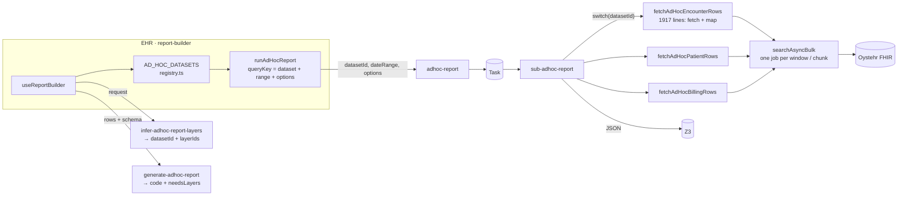
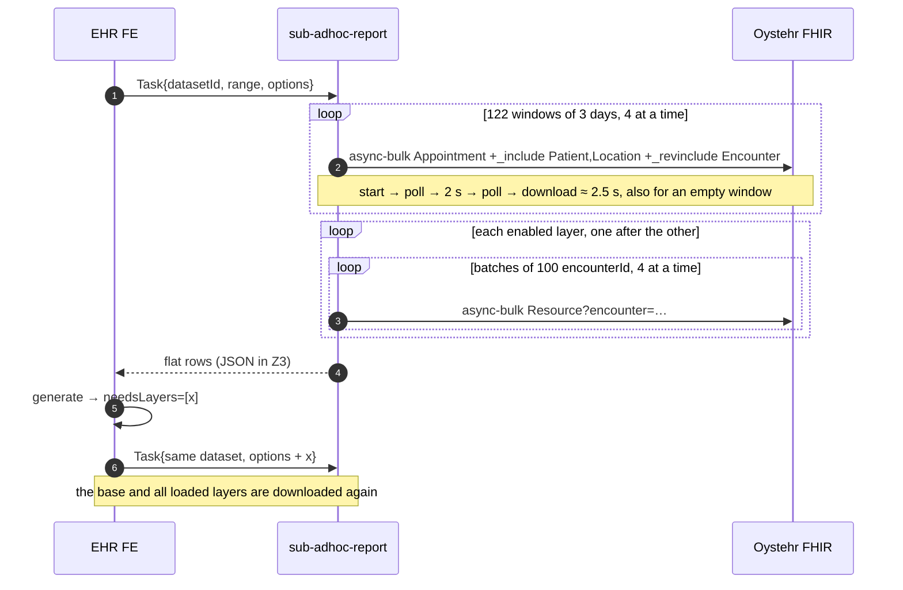
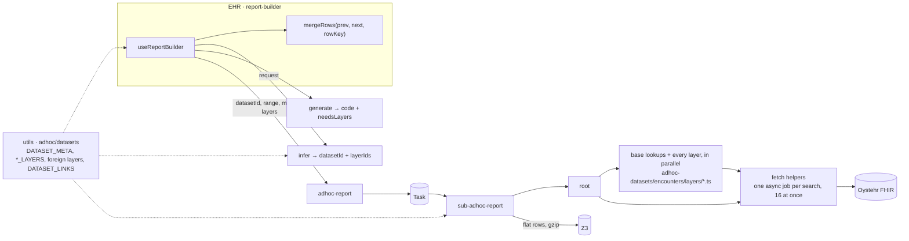
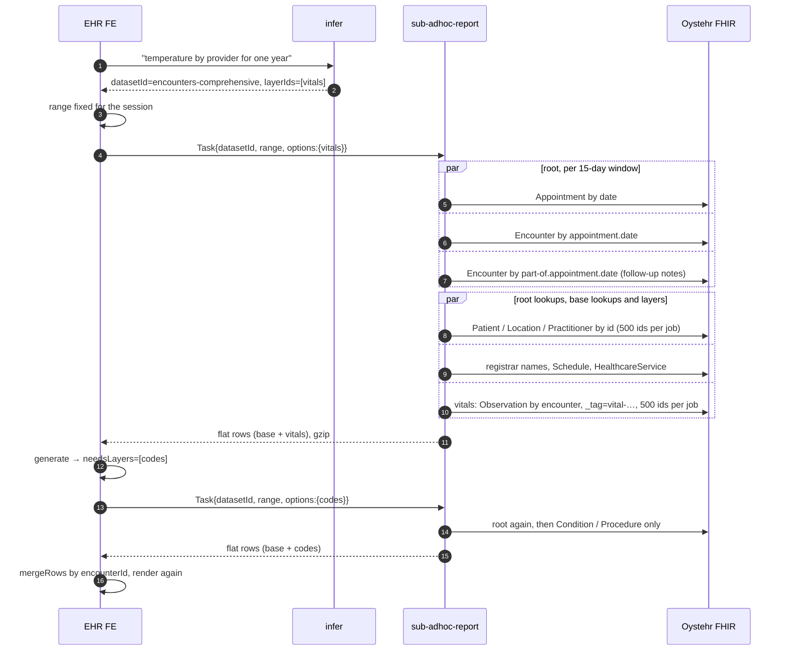
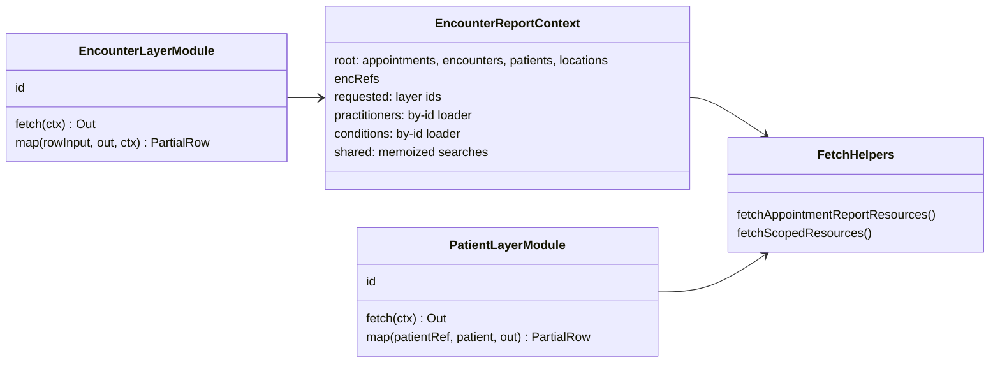
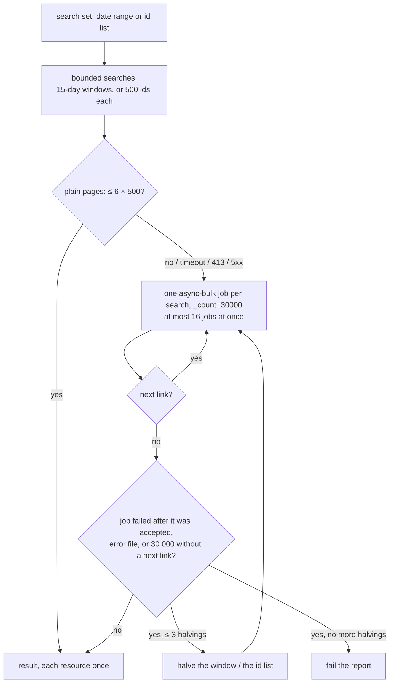
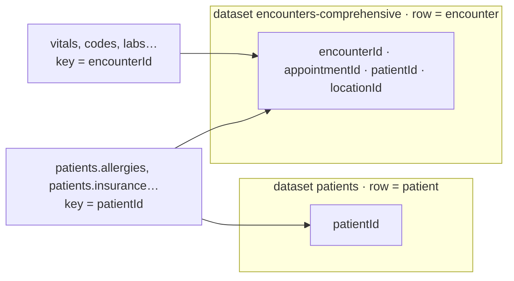

# Ad-hoc reports: layers instead of datasets — dev design

Repository: `local/core`. All paths are relative to it. Status: **prototype**, implemented 2026-11-11, tuned on synth 2026-11-20; links between datasets (section 2.9) implemented 2026-11-25, not yet run on real data.
Numbers marked "(SC)" come from the document "Ad hoc reports: speed and completeness" and are not re-measured. Other numbers are measured on `local` or synth with the tools in section 6.

**Summary**

- **Stays as is:** the Task transport, the saved report format (`datasetId` + `criteria.options`), the LLM generation, the start input, the output (flat rows), and the names: dataset, layer, `ENCOUNTER_LAYERS`, `AdHocLayerDef`, `fetchAppointmentReportResources`, `fetchScopedResources`. Report code gets the same flat rows as before.
- **Changes:**
  - every FHIR search is **bounded** (a 15-day window or 500 ids) and runs **first as up to 6 plain pages, as an async-bulk job only when larger** (a job costs ~2.5 s however little it returns), 16 at once, with a split rule that never returns a part of the data;
  - the monolithic `fetchAdHocEncounterRows` / `fetchAdHocPatientRows` became **one module per layer**; the worker loads root, then all requested layers in parallel;
  - the front end loads **only the missing layers** and merges them into the rows it has;
  - a layer is bound to a **base field** (`encounterId`, `patientId`), not to a dataset, so the patients dataset's layers are also offered on the encounters and billing rows (`patients.allergies`, …);
  - a visit row can also carry the columns of the **linked datasets**, joined in the worker by `encounterId`: the visit's claim from the billing app (`billing-claims.*`) on the encounters and visit-payments rows, and the visit's payments and charges (`billing.*`) on the encounters rows (section 2.9, plan and reasons in [adhoc-dataset-links.md](adhoc-dataset-links.md));
  - the report data is stored gzip.
- **Result on synth** (90 days, ~4 700 visits, five typical reports, 2026-11-20): even with Report Studio's runner or faster — by the median of three passes, faster on four reports of five and within noise on the fifth; every result matched the hand-written searches.
- **Result on local:** the encounters dataset with 5 layers loads 5× faster over 60 days with identical rows; a year (~43 500 visits) takes ~100 s, where the old code did not finish within the 13-minute budget. Settings may need tuning on production data (section 7).
- **Difference from Report Studio:** the fetch mechanics are the same kind (bounded searches, parallel jobs, split rules). The layer code decides what to fetch, not an LLM plan, so there are no server-side value filters and no count-only steps.

---

## 1. Before

### 1.1 Components



### 1.2 Execution (one year, encounters dataset)



### 1.3 Problems

| # | What | Cost |
|---|---|---|
| 1 | The base search is cut into windows of 3 days, one async-bulk job each, 4 at a time | ~2.5 s per job; one year ≈ 93 s (SC) |
| 2 | Each window returns Patient and Location in full; the same Patient comes back from many windows | extra MB per report |
| 3 | Layers load one after the other with `await`, though they do not depend on each other | time = sum of all layers |
| 4 | Search by id list: batches of 100, one job each, 4 at a time | hundreds of jobs per layer for a year |
| 5 | All Observations of a visit load for the vitals layer | over-fetch |
| 6 | A result of exactly 30 000 without a next link is not detected | data lost without an error |
| 7 | `needsLayers` downloads the full dataset again | ×2 time per generation |
| 8 | A layer is a flag with its logic in two places of one 1 917-line file; dependencies are implicit | a new or changed layer is expensive |
| 9 | One dataset per report; a cross-dataset request is rejected | "visits + allergies" is impossible |
| 10 | After the layers, three more searches run one after the other (registrar names, schedules, groups) | seconds on every report |
| 11 | The output JSON is not compressed | 4.5–13 s of download on large reports (SC) |
| 12 | A dropped connection fails the whole report: no retry | a year often failed on local |

---

## 2. Design

### 2.1 Principles

1. A **layer** is one module: `fetch` + `map` in one file. Searches several layers need, and by-id lookups, are memoized functions in the report context.
2. A **dataset** stays the row type of the result (encounter, patient, …) and keeps its id.
3. No layer calls FHIR directly. All searches go through the two fetch helpers in `shared/adhoc-report.ts`, which own the search size, the job pool, the next link and the split rule.
4. The output stays **flat rows**. The server glues the layers into rows. The report code contract does not change.
5. The front end requests only the **missing layers** and merges them into its rows by the row key.

### 2.2 Components



The billing-app datasets (`billing-claims`, `billing-rules`) are still served by their own zambda and worker. In addition, `sub-adhoc-report` reads the claims of a report's visits itself when a `billing-claims.*` layer is requested (section 2.9): it already held a billing client for the payments layer, and it calls the same claims builder (`billing/adhoc/claims.ts`).

### 2.3 Execution



Run order in the worker (`adhoc-datasets/encounters/index.ts`):

1. **Root** (`root.ts`, `fetchReportVisits`): three searches side by side — appointments by date, encounters by `appointment.date`, follow-up encounters by `part-of.appointment.date` (by parent id if the server refuses that chain). Encounters are kept by the old revinclude rules. Patients and locations start loading as soon as the appointments are in, before the encounters.
2. **In parallel:** the root lookups (patients, locations and the attending / intake practitioners by id — `ctx.rootLookups()`, once), the base lookups (registrar names, location schedules, provider groups), every requested layer's `fetch`, and the requested foreign patient layers. Each needs only the root; the job pool limits the requests, not the layers.
   - Most layers do not read patients or locations, so they no longer wait for them. The few that do while fetching await `rootLookups()` themselves: employer, paperwork, the foreign patient layers, the lab / nursing orders, the location schedules, and the practitioner loader. The root's practitioners (with the provider-type extension) therefore still land in the practitioner map before any other lookup, and the rows are the same as with the lookups first.
   - This saves one round of jobs (~2.5–4 s) on every report. The patients and billing datasets keep the lookups inside the root: they need the patients to build their rows.
3. **Rows:** one per encounter — the base row, then each layer's `map`, then the foreign columns by `patientId`.
   - **Links**, after the rows are built and outside the dataset builder (`applyDatasetLinks`, section 2.9): only when a link layer is requested; the sources are fetched at once and joined by `encounterId`. Logged as `[adhoc] link <host> <- <source>: layers=… keys=… sourceRows=… ms=…` and `matched=…/…`.
4. A log line shows where the time went: `[adhoc] encounters timing: rows=… root ms=… layers ms=… map ms=… | <layer>: fetch … map …`, with each shared search (`shared.procedures: fetch …`), each foreign layer and its steps (`patients.visitHistory.seenBeforeAnswers: fetch …`). Each visits search and base lookup logs its own time too.

There is no dependency graph: no layer depends on another layer. A layer needs the root and, at most, a shared search or a by-id loader.

### 2.4 Layer modules and the report context



- **Encounter layers:** `shared/adhoc-datasets/encounters/layers/*.ts`, 20 modules, one per id in `ENCOUNTER_LAYERS`. `map` gets the row's encounter, appointment, patient, attending practitioner, follow-up flag, visit status and status history.
- **Shared searches** (`context.ts`, each runs once per report, on first use): diagnoses, procedures, document references, service requests, medication administrations, all Observations, encounter conditions, intake paperwork, lab / nursing orders.
- **By-id loaders** (`memo.ts`): practitioners and conditions. An id is requested once per report, whoever asks.
- **Vitals** search Observations by the vital tags only, unless `examRos` or `intake` is loaded too; then the three read one untagged search. **One-vital layers** (`vitalsTemperature`, `vitalsBloodPressure`, `vitalsHeartRate`, `vitalsRespiration`, `vitalsOxygen`, `vitalsBody`) have the same columns and load only their own tag: a temperature report spent 7.3 s on the full layer against 1.1–2.0 s on `vitalsTemperature`. Their descriptions and infer's prompt say to pick the smallest layer that covers the request; a layer whose fields another picked layer already has is dropped (`parseDatasets`).
- **Lab / nursing orders** are mapped one order at a time, each with only its own Tasks, reports, Observations and Encounter (indexed once). Handed the whole report, the EHR mappers compared every order with every resource: 589 s on synth (UC 18).
- **Visit history** (`patients.visitHistory`) loads the prior visits and the seen-before screening answers side by side, both through the fetch helpers; `resolveNewPatients` takes the answers ready-made, so the rule stays the one of the Recent Patients report and the E&M suggestions.
- **Patient layers:** `shared/adhoc-datasets/patients/layers.ts`, 12 modules, keyed by patient. The account picture is loaded once for the contacts, insurance, eligibility and employers layers. `fetchPatientLayerColumns` gives the columns of any of them for any patients — the patients dataset and the foreign layers use it.
- **Billing dataset:** still one function; its independent layers now load in parallel.

### 2.5 Fetch helpers

A bounded search first runs as **plain pages** of 500: the first asks `_total=accurate`, then exactly the pages needed are read side by side. More than 6 pages, a timeout, 413 or a 5xx → the same search runs as an **async-bulk job** (start → poll every 1 s → download), with `_count=30000`. A 4xx fails the report. On synth most id chunks and 15-day windows fit in one to five pages, which saves the ~2.5 s a job costs.



| Limit | How the helpers handle it |
|---|---|
| A job without `_count` returns 1 000 resources (OTR-3686) | every job sends `_count=30000` |
| One result page holds 30 000 resources | follow the manifest's next link (OYST-3505); 30 000 without a link → halve the search |
| One query may run 30 s in the database | bounded searches; a job that fails after it was accepted is halved. On local the 30 s limit answered **400 with no body**, not 500, so any status counts |
| A bad request | refused when the job is started; not split, the report fails with the message |
| A 5xx, timeout or dropped connection when the job is started or downloaded | halved and run again |
| Halvings run out | the report fails; a part of the data is never returned |

- Constants (`adhoc-report.ts`): `DEFAULT_WINDOW_DAYS = 15`, `IDS_PER_ENTRY = 500`, `JOBS_IN_PARALLEL = 16`, 6 plain pages of 500, 3 halvings. `ADHOC_IDS_PER_SEARCH`, `ADHOC_JOBS_IN_PARALLEL`, `ADHOC_SYNC_PAGES` (0 = async jobs only, as before) and `ADHOC_SYNC_PAGE_SIZE` override them for tuning runs. Measured on synth: pages of 1 000 were slower (14.3 s against 9.1 s), and 24 slots instead of 16 made no difference (r5: 12.6 / 11.4 s against 12.3 / 11.2 / 14.7 s).
- The pool counts jobs: one job, from start to download, holds one slot. A job waits for nothing else in the pool, so it cannot deadlock; halvings and next links run after the slot is free.
- Patients and locations are loaded by the ids in the appointments, once per report, not as an `_include` in every window.

### 2.6 Contracts

```ts
// utils/lib/types/adhoc/datasets/dataset.ts — AdHocLayerDef gets one optional field
interface AdHocLayerDef {
  label: string; description: string; default?: boolean;
  key?: string;   // the base field the layer is keyed by; omitted on a dataset's own layers (its row key)
  schema: z.ZodObject<z.ZodRawShape>;
}
// Another dataset's layers on this one: `<sourceId>.<layerId>`, only the fields this dataset does not have.
function foreignLayers(params: { sourceId; sourceLabel; source; key; base; native }): AdHocLayerMap;

// utils/lib/types/adhoc/datasets/meta.ts
const DATASET_META: Record<string, { rowKey: string; baseSchema: ZodObject; layers: AdHocLayerMap }>;
function layersForDataset(datasetId: string): AdHocLayerMap;   // own + foreign layers

// encounters.ts / billing.ts
ENCOUNTER_FOREIGN_LAYERS, ENCOUNTER_ALL_LAYERS   // patients.* on encounter rows, by patientId
BILLING_FOREIGN_LAYERS, BILLING_ALL_LAYERS       // patients.* on visit-payment rows, by patientId

// adhoc-report start input: NO CHANGE — options = the layers the caller does not have yet
//   (a foreign layer's flag is `includePatients.allergies`)
// Task output: NO CHANGE — flat rows; stored gzip
// infer: NO CHANGE in shape; the prompt says a foreign layer covers the other dataset's facts
// generate: NO CHANGE — needsLayers stays
```

- `encounterId` is required on the encounters and billing rows: it is the merge key.
- Foreign layer ids carry the dataset prefix, so they never collide with a dataset's own ids (`medications` exists in encounters and in patients) and old saved reports never contain them.
- Runtime validation is unchanged: the worker parses its input and validates its output with the Zod schemas built from the same layer maps the LLM sees.

Front end (`report-builder/page/useReportBuilder.ts`, `query/merge-rows.ts`, `query/dataset-query.ts`):

- The range is fixed for the session (same dataset and date controls). A range "until now" would gain visits every minute and change the row set between two loads. An explicit fetch starts a new session.
- `mergeRows(prev, next, rowKey)`: each row of `next` (base + the new layers) gets the fields of the `prev` row with the same key. When the two are not the same set of rows, every layer is loaded again.
- The data file is inflated in the browser (`DecompressionStream`); a plain JSON file from an older Task still reads.
- The Task status is polled every 2 s, the first check 2 s after the start (each check is a zambda call; every second would double them for ~0.5 s of average wait). The worker's own polling of each async job stays at 1 s: there a 2 s poll would add ~0.5–1 s to every round of jobs.

### 2.7 Any data, not one dataset



| Report | Before | Now |
|---|---|---|
| Visits + patient allergies | rejected (two datasets) | encounters + `patients.allergies` |
| Visit payments + patient language | rejected | billing + `patients.demographics` |
| Patients + diagnoses of their visits | `visitHistory` only | unchanged (no "many" layers) |
| Visits + claim status (billing app) | rejected | encounters (or billing) + `billing-claims.base` (section 2.9) |
| Visit duration or AI use + claim amounts | rejected | encounters + `timing` / `ai` + `billing-claims.base` |
| Visit attributes + charges / patient payments | rejected | encounters + `billing.charges` / `billing.payments` |
| Patients + claims (no visit dataset picked) | rejected | infer folds it into encounters + `patients.*` + `billing-claims.*` |
| Two independent tables in one report | no | unchanged: it would change the report code contract |

"Any data" means data with a layer module; each new kind of data is one new module.

### 2.8 Compatibility

| What | How |
|---|---|
| Saved reports | No change: `datasetId` and `criteria.options` keep their meaning |
| Report code (JSX) | No change: same flat rows, same schema |
| Rows | The fixture tests pass unchanged; the rows were compared against the old code and are identical (section 6) |
| System reports / Report Studio | Not affected |
| Links between datasets (section 2.9) | A link layer is one more key in `criteria.options`; rows stay flat; reports saved before contain none of them |

### 2.9 Links between datasets

Plan, reasons and rejected options: [adhoc-dataset-links.md](adhoc-dataset-links.md). What is in the code:

| Host rows | Columns from | Layer ids on the host | Column prefix | Source rows fetched |
|---|---|---|---|---|
| encounters | Claims (billing app) | `billing-claims.base` + 9 layers | `claim` | by the host's encounter ids |
| encounters | Visit payments & charges | `billing.*`, 5 layers (no `.base`: the visit header is shared) | `billing` | by the host's date range |
| billing (visit payments) | Claims (billing app) | `billing-claims.base` + 9 layers | `claim` | by the host's encounter ids |

The visit is the hub: the encounters rows can carry patient, visit-finance and claim columns in one report. Patients, claims, medication inventory and billing rules are not hosts of a link. `patients.*` (section 2.6) is a different mechanism and is unchanged.

- **Declared once:** `DATASET_LINKS` in `utils/lib/types/adhoc/datasets/links.ts` — host, source, the two key fields, the prefix. A link exists only when it is listed. `linkLayers` builds a link's layers from the source's **own** layers; each host dataset file adds them to its `*_ALL_LAYERS`, next to `patients.*`, so the input and output schemas, the layer checkboxes, the infer catalog and the LLM schema pick them up.
- **Columns:** `<prefix><Field>` (`claimBilled`, `claimCptCodes`, `billingExpectedCharge`); a field that already starts with the prefix keeps its name (`claimType`). They never clash with the host's columns: `cptCodes` is charted, `claimCptCodes` is billed (a unit test checks every host). Every link column is nullable, and every layer of a link declares `<prefix>Matched` (`claimMatched`, `billingMatched`): false = the visit has no such record and its columns are null, not zero.
- **Domain and internal fields** of the link columns follow the source dataset's lists: `ENCOUNTER_DOMAIN_FIELDS` and `BILLING_DOMAIN_FIELDS` are now the dataset's own list (`*_NATIVE_DOMAIN_FIELDS`) plus the derived link columns. The internal lists are unchanged: a link never carries the source's internal fields.
- **Join:** `joinRows` (`utils/.../datasets/join.ts`), a lookup. Host rows are never added or dropped; a source row with an empty key is skipped (a claim created by hand); on two source rows with one key the smallest source row key is kept and the count is logged.
- **Worker:** `applyDatasetLinks` (`zambdas/src/shared/adhoc-datasets/links.ts`), called in `sub-adhoc-report` after the host rows are built. `LINK_SOURCES` says how each source's rows are built: `fetchAdHocClaimRows` with `encounterIds` (an identifier search by `claim-encounter-id` instead of the scan of every claim) and `deadline` (the report's budget), and `fetchAdHocBillingRows` for the host's range. A report with no link layer makes no extra request.
- **Imports go one way:** `encounters.ts` → `billing.ts` → `billing-claims.ts`. `PAYMENT_VARIANT_VALUES` moved to `datasets/payment-variant.ts` so that `billing.ts` does not import `encounters.ts`.
- **Infer** (`foldIntoForeignLayers`): a dataset picked with no layers folds into the host's `<dataset>.base`; when the host is linked to it but offers no `.base`, it is dropped; and the host may be a dataset the model did not pick (Patients + Claims → encounters).
- **Generation:** one prompt rule, LINKED RECORDS — prefixed columns, and `…Matched` false means null, not zero.
- **Cost:** a `billing-claims.*` layer costs the claim lookup for the host's visits plus the layer's own searches; a `billing.*` layer on encounters costs a second pass of the visit root search. Nothing else changes for existing layers.
- **Access:** one role check, in `adhoc-report`. `adhoc-billing-dataset` requires the same roles; a unit test pins the two together.

`<prefix>Matched` is declared by every layer of a link, so `llmFieldsForLayers` lists a field name once, where it first appears: that list is both the model's schema and the columns of the raw-data grid.

---

## 3. What was learned on the way

- **A batch Bundle as one async job loses data.** The first plan put many searches into one batch job to pay the job cost once. Measured on local: every search inside it stopped at exactly 1 000 resources (two 15-day windows → exactly 2 000 appointments, five jobs in a row), and a by-id search with more than 1 000 matches came back empty (batch 0, the same search alone 1 054) — with no error, no error file and no next link. The output does not say which search returned what, so the loss cannot be detected. Dropped: one job per search.
- **The Appointment count for a year timed out at 14 s.** It was only meant to size the windows; fixed 15-day windows are far under one page. Dropped.
- **The database's 30 s limit answers 400 with no body**, not 500. The split rule now treats any failure of an accepted job as "did not finish".
- **Time is mostly the fixed cost per job**, not data and not mapping (mapping a year: ~1.5 s). Fewer, larger searches and more jobs at once are what helps.

Learned on synth (2026-11-20), each found by timing the steps first:

- **Plain pages before an async job.** A small search as a job costs ~2.5 s; as one or a few pages, 0.1–1 s. r1 went from 22.9 s to 9.1 s.
- **Mapping can be quadratic without looking like it.** The EHR lab mappers scan the lists they are handed; with a report's thousands of orders that was 589 s (UC 18). Clinic open hours re-parsed the Schedule extension on every row: ~1 s of the 2 s base map. Both are now indexed or cached.
- **Steps that wait for each other cost their sum.** Visit history ran the prior visits, then the screening answers (4.3–5.7 s); side by side it is the longer of the two (1.7–3.0 s).
- **Payload size did not matter here.** The codes layer loads whole Conditions and every Procedure, Report Studio only `_elements` and the CPT tag: both take ~3 s. Trimming would add code for nothing.

## 4. Risks and open questions

- **Production-like data.** `local` has many visits and few clinical records per visit. On real data a 500-id search carries far more records and may reach the 30 s limit: it then splits (slower, still complete). Watch the worker logs there for `split` / `FAILED` lines; lower `ADHOC_IDS_PER_SEARCH` if splits are frequent.
- **Load on the Oystehr project.** 16 jobs per report; several reports at once multiply that.
- **Dangling references in the data.** A medication order whose patient is not among the loaded patients is skipped by the app's order mapper, as before; on local this logs one stack trace per order.
- **The LLM picks the dataset and layers.** The infer catalog is longer with the foreign layers and longer again with the link layers (encounters: 38 → 53 layers, ~290 → 432 fields). There is no infer eval set in the repository yet; it has to be put together before this can be checked (acceptance in [adhoc-dataset-links.md](adhoc-dataset-links.md), section 6).
- **Links share the worker's budget.** The host rows and the linked sources are built in one run of 13 minutes; a long range with heavy layers on both sides may not fit. Not measured on real data yet.
- **Small reports** still pay the Task round-trip (~2 s); a direct call is not in this design.
- **Not covered:** the data kinds missing from the layer maps, clinical columns on claim rows (claims as the host), links of the medication inventory, "many" layers, two tables in one report, server-side value filters and count-only steps (Report Studio has them).

## 5. Report Studio, for comparison

| | Layers (this design) | Report Studio (LLM plan + runner) |
|---|---|---|
| Fetch mechanics | bounded searches, parallel jobs, split rules | the same kind |
| Query shape | fixed, in the layer code | custom per report |
| Server-side value filters, count-only | no | yes |
| Data traps (empty dates, follow-up without `end`) | handled once in code | plan checks + data map |
| Report storage | no change | new model (`plan`, `inputs`) |
| New data kind | new module (code) | change in the data map |
| LLM errors in the fetch | not possible | possible |

## 6. Measurements

Measured on local (encounters dataset with codes, vitals, medications, labs, signing; server-side fetch only):

| Data | Old code | New code |
|---|---|---|
| 60 days, 1 119 visits | 106 s | 21 s (5×), rows identical |
| a year, ~43 500 visits | did not finish (13-minute budget; dropped connections) | 336 s at 250 ids / 8 jobs, 185 s at 500 / 8, **101 s at 500 / 16**, no splits |

## 7. Rejected options

| Option | Why not |
|---|---|
| Batch Bundle as one async-bulk job | measured: each search in it stops at 1 000 or comes back empty, without an error (section 3) |
| Window size from an Appointment count | measured: the count for a year timed out at 14 s; fixed windows suffice |
| Planner with stages, Executor, Strategy classes, a Catalog object | the same work in more code; no layer depends on another layer |
| Time-based split of a job that is still running | not deterministic: a cold cache is 3–5× slower (SC) |
| Sync search only | the 14 s and 6 MiB limits of a sync call; plain pages are used first and fall back to an async job (section 2.5) |
| Direct zambda call for small reports (no Task) | a second transport with a 27 s cap |
| Server snapshot of the root keys | not needed once the range is fixed per session |
| Rename dataset → grain; infer by fields | no user value; the old names are in the prompts, saved reports and code |
| "Many" layers, automatic key bridges, billing sub-requests | more code per layer; breaks the clinical/billing boundary |
| `Group/$export`, `async-bundle` mode | no date filter and full compartments; the 1 000 / 6 MiB page limits stay |
