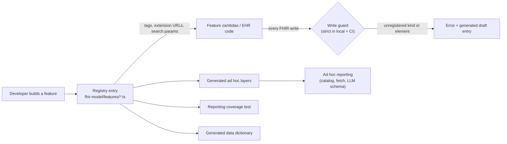

# Plan: a FHIR model registry that ad hoc reporting is built from

**Status:** proposal. **Touches:** `packages/utils`, `packages/zambdas`, `apps/ehr`, CI.

## Summary

Ad hoc reporting misses new features because no one ever declares the FHIR model a feature writes. The
model exists only as string literals in the zambdas that write it. The reporting datasets learn it when
someone reads that code later, usually weeks later. A reminder can't fix this: the developer who knows the
model isn't thinking about reporting when they write it.

The plan is to make the FHIR model a typed registry with three properties:

1. **It is the only source of a feature's FHIR identifiers** (tags, extension URLs, code systems,
   identifier systems). Feature code imports them from its registry entry, and the lint check rejects new
   identifiers written anywhere else.
2. **Every FHIR write is checked against it** in local dev and CI. A guard in the zambda client factories
   rejects a resource that matches no registered kind, or that carries an element its kind doesn't declare.
3. **Ad hoc reporting is built from it.** Every declared element can be reported by default, through
   generated dataset layers. A coverage test fails when a registered kind has no reporting decision.

A developer can't save a new kind of resource from their local EHR until it's declared. Once it's
declared, ad hoc reporting can query it in the same PR, with no dataset mapper to write.

---

## 1. Why reporting keeps falling behind

### How the datasets are built today

- There are three datasets. Encounters has base columns plus 20 opt-in layers, Patients has 12 layers,
  and Billing has 5. The column schemas and their LLM-facing descriptions are in
  `packages/utils/lib/types/adhoc/datasets/`. The fetch and mapping code, about 4,400 lines, is in
  `packages/zambdas/src/shared/adhoc-datasets/`.
- Each layer re-derives a feature's FHIR model from that feature's code: which resources it writes,
  which tag finds them, and which extension holds which value.
- The layer plumbing is already generic. UI checkboxes, `include<Layer>` flags, the LLM catalog and the
  row schema all derive from one layer map (`packages/utils/lib/types/adhoc/datasets/dataset.ts`). What's
  manual is everything feature-specific: each layer's schema and its fetch-and-map code.

### Evidence

| Feature | FHIR model introduced | Reportable | What happened |
| --- | --- | --- | --- |
| Patient-level notes | 2026-09-07 (#9402) | 2026-10-01 (`b2b45426e`) | The tag `…/patient\|patient-note` is written inline in four of the feature's zambdas under `packages/zambdas/src/ehr/patient-notes/` (`create/index.ts:15-16`, `get/index.ts:22`, `count/index.ts:19`, `update/index.ts:19`). Reporting copied it a fifth time into `packages/zambdas/src/shared/adhoc-datasets/patients.ts:72`. If the feature changes the tag, reporting silently returns nothing. |
| Radiology: who pressed "Send for Final Read" | 2026-08-19 (#9169) | 2026-10-15 (`bfac7effc`) | The reporting maintainer documented the extension's meaning eight weeks after it shipped, including that it is "not recorded on older studies". The feature's developer knew both facts on day one. |
| Outbound fax, provider notifications | — | not reportable | Both have careful prose descriptions of their FHIR model (`docs/outbound-fax.md`, `docs/provider-notifications.md`). Reporting can't consume prose. The datasets hold contacts' fax numbers, but no fax sends or notifications. |

29 of the 31 non-merge commits to the dataset files come from one maintainer, while 24 different authors
changed EHR features and zambdas since August alone. So in practice, reporting is one person working out
everyone else's data model, weeks after it ships.

### Root cause

The FHIR model is never declared. In non-test source alone, it is spread across:

- 185 distinct `fhir.ottehr.com` / `fhir.zapehr.com` URL literals, in 59 files (269 counting config JSON
  and tests);
- about 200 lines that build URLs from `PRIVATE_EXTENSION_BASE_URL`, and 53 `ottehr*Url()` calls;
- 20 `fillMeta(code, system)` calls (`packages/zambdas/src/shared/helpers.ts:180`), most with string
  literals.

Nothing stops a new identifier from appearing, and nothing connects one to reporting.

---

## 2. Design



### 2.1 The registry

The registry goes in a new directory, `packages/utils/lib/fhir-model/`. It belongs in `utils` because the
zambdas, the EHR and the ad hoc schemas all import from there.

```
fhir-model/
  define.ts              defineFhirFeature / defineKind, element types, Zod validation of entries
  namespaces.ts          the only module allowed to mint ottehr/zapehr URLs (absorbs fhir/systemUrls.ts)
  common.ts              cross-cutting tags allowed on any kind (test-run ids, created-by, billing system tags)
  registry.ts            FHIR_MODEL = { patientNotes: PATIENT_NOTES_MODEL, … }, a typed map
  match.ts               matchKind(resource), elementKeys(resource): shared by the guard and the tests
  features/
    patient-notes.ts
    radiology.ts
    vitals.ts
    …
  legacy-baseline.json   grandfathered kinds, elements and literals (shrink-only)
```

`registry.ts` follows the pattern of `CHART_SECTION_DEFINITIONS`
(`packages/zambdas/src/shared/chart-sections/registry.ts:17`). It imports each module into a record, which
is not a re-export, so it fits the no-barrels rule.

A feature declares **kinds**. A kind is one family of resources the feature writes. Its declaration gives:

- the discriminator that finds those resources;
- how they link to a patient, encounter or appointment (the reporting *grain*);
- their elements, each with a description written for the reporting model;
- a *disclosure* class that controls what may reach the LLM;
- a reporting decision.

```ts
// packages/utils/lib/fhir-model/features/patient-notes.ts
export const PATIENT_NOTES_MODEL = defineFhirFeature({
  id: 'patientNotes',
  title: 'Patient notes',
  description:
    'Free-text notes staff keep about a patient, shown on the patient page and the visit header. Not tied to a visit.',
  kinds: {
    note: defineKind<Communication>({
      description: 'One patient note.',
      identity: { tag: privateTag('patient', 'patient-note') },
      grain: { patient: { searchParam: 'subject', ref: (r) => r.subject?.reference } },
      elements: {
        payload: {
          as: 'text',
          get: (r) => r.payload?.[0]?.contentString,
          type: 'string',
          disclosure: 'narrative', // never sampled into the prompt
          description: 'Note text as typed by staff.',
        },
        sender: { as: 'author', type: 'practitioner', description: 'Staff member who wrote the note.' },
        sent: { as: 'writtenAt', type: 'instant', description: 'When the note was written.' },
        status: {
          type: 'string',
          values: ['completed', 'entered-in-error'],
          disclosure: 'code', // safe to sample distinct values
          description: 'entered-in-error = deleted; the app hides deleted notes.',
        },
        subject: { type: 'reference', disclosure: 'internal', description: 'The patient (join key).' },
      },
      reporting: 'auto',
    }),
  },
});
```

The feature's code then takes every identifier from the entry, so the five copies of the tag become one:

```ts
const { note } = PATIENT_NOTES_MODEL.kinds;

await oystehr.fhir.create<Communication>({ resourceType: 'Communication', meta: note.meta(), … });
await oystehr.fhir.search<Communication>({ resourceType: 'Communication', params: [...note.searchParams(), …] });
```

**Identity forms.** A kind is identified by one of the following:

- a `tag` (system and code);
- a `tagSystem`, optionally with a list of codes. This covers families such as exam observations, whose
  code is the exam field name. The list comes from the same constant the feature uses.
- a `code` (a system, and optionally a code, on `code`, `type` or `category`);
- a `profile`;
- an `identifierSystem`.

Every resource the app writes must match exactly one kind.

**Element keys.** A kind's elements are declared at these levels:

- top-level properties;
- `extension` and `modifierExtension` entries, keyed by URL (nested extensions too);
- `identifier` entries, keyed by system;
- any coding system in the Ottehr namespaces.

`resourceType`, `id`, `meta` and `text` are implicit. The declaration covers only the key, so whatever
is nested under a declared key needs no declaration of its own. These are the levels at which a feature
adds new data, and they are coarse enough that declaring them is quick.

**Writers outside our code.** Some resources are written by Oystehr-managed services (eRx, labs, RCM) or
by external integrations. They are declared as `writer: 'external'` kinds. They are documented and can be
reported, but they aren't guarded.

### 2.2 What forces the declaration, and when the developer hits it

| When | Mechanism | Effect |
| --- | --- | --- |
| Writing the code | Identifiers come only from the registry. `namespaces.ts` is the only module allowed to mint URLs. | A new tag or extension URL written outside the registry fails `npm run lint`. |
| First local save | **Write guard**, strict in the local zambda server | The request fails with a message naming the unregistered kind or element, plus a generated draft entry. |
| PR CI | `npm run lint:fhir-model`, the registry schema test, the reporting coverage test, the strict guard in integration + E2E suites, the docs staleness test | The PR can't merge with a new literal, a new kind or element, or a kind with no reporting decision. |
| Review | Generated PR summary ("new kind X, exposed as Patients › Patient notes"). Optionally, CODEOWNERS on `fhir-model/` | The reporting impact is visible and gets reviewed. |
| Deployed | Guard in report mode (Sentry warning, never throws) | Catches code paths that no test or local run exercised. |

#### Lint and type lockdown (static)

- `scripts/fhir-model-check.ts --check` uses the TypeScript compiler, the same approach as
  `scripts/debarrel.ts`. It runs as `npm run lint:fhir-model`, wired into `npm run lint` next to
  `lint:barrels`. It fails on any of the following outside `fhir-model/`:
  - an Ottehr-namespace URL literal;
  - a template literal that builds such a URL;
  - an import of `PRIVATE_EXTENSION_BASE_URL` or the `ottehr*Url()` helpers;
  - a `fillMeta` call with string-literal arguments.
- Existing hits go into `legacy-baseline.json`. The check compares the baseline with the PR's base
  branch and fails if the baseline grew. It also fails if an entry no longer exists, so the baseline can
  only shrink.
- The script ignores `eslint-disable` comments. The only escape hatch is the baseline file, and adding to
  it is a visible diff.
- In-editor squiggles come later, from a small local ESLint rule that shares the matcher and the baseline.
  Lint runs with `--max-warnings 0`, so a plain `warn` rule would fail on the legacy hits.
- Kinds expose typed helpers (`meta()`, `searchParams()`, `extension(key, value)`). New code uses these
  instead of `fillMeta`, and the check flags new `fillMeta` calls.

#### The write guard (runtime)

The guard can catch what static analysis can't. It sees URLs built dynamically, tags that come from
config (for example `fillMeta(data.field, metaSystem)`), a new resource type that uses only standard
codes, and a new element on an existing kind.

- **Where it's installed.** The guard wraps `fhir.create`, `update`, `patch`, `batch` and `transaction`
  in these client factories:
  - `createClinicalOystehrClient` (`packages/zambdas/src/shared/helpers.ts:66`, used by 391 files);
  - `createOystehrClient` (`packages/utils/lib/helpers/helpers.ts:54`);
  - the billing factories in `packages/zambdas/src/billing/shared.ts`.

  The EHR also writes to FHIR directly, in 18 `create`/`update`/`patch`/`batch` call sites across 14
  files. When `VITE_APP_IS_LOCAL` is set (the flag that points the EHR at the local zambda server), the same
  matcher wraps the EHR's own client (`apps/ehr/src/hooks/useAppClients.tsx`).
- **What it checks.** It checks three things. Each resource being written must match exactly one kind.
  It may carry no undeclared element key. Every Ottehr-namespace URL in it must be declared on that kind.
  For a patch, the guard checks the resource the server returns. For a batch or transaction, it checks
  each entry.
- **Modes.** The mode is set with `FHIR_MODEL_GUARD`. It works like `LEAK_GATE_MODE` in
  `packages/zambdas/test/helpers/integration-leak-gate.ts`.
  - `strict` throws. It is the default in the local server (`packages/zambdas/src/local-server/index.ts`).
    That default reaches the integration suite, which imports the local server, and E2E, which starts it.
  - `report` logs and sends a Sentry warning. It is the default in deployed non-prod environments.
  - `record` appends fingerprints to `.fhir-model/observed.jsonl`, for bootstrapping.
  - `off` is the default in production. A sampling mode for production can come later.
- **Attribution.** `wrapHandler` (`packages/zambdas/src/shared/sentry.ts:105`) already knows the zambda
  name, so every violation names the zambda that wrote it.
- **Error message.** The message is meant to be fixed mechanically, by a person or by Claude Code:

  ```
  FHIR model guard: Communication matches no registered kind.
    written by: create-patient-note
    meta.tag:   https://fhir.zapehr.com/r4/StructureDefinitions/patient|patient-note
    elements:   payload, sender, sent, status, subject
  Declare it in packages/utils/lib/fhir-model/features/<feature>.ts.
  Draft written to .fhir-model/drafts/create-patient-note.ts (npm run fhir-model:scaffold)
  ```

#### CI gates

- **Registry schema test.** Every entry passes the Zod schema. Descriptions are non-empty, have a minimum
  length, and contain no `TODO`. Disclosure classes are set. Layer ids don't collide. `legacy: true` is
  allowed only for ids that are in the baseline.
- **Reporting coverage test.** See §2.3.
- **Strict guard in the integration and E2E suites.** An unregistered write fails the suite, the same way
  the leak gate can.
- **Generated data dictionary** (`docs/fhir-model/`), with a staleness test. This follows the precedent
  of `docs/billing-rules-engine.md` and `rules-engine.docs.test.ts`.

### 2.3 How ad hoc reporting consumes the registry

**Default: a declared element can be reported.** Every declared element is exposed through a generated
layer unless one of two things is true:

- it is `excluded`, with a reason from an enum (`config`, `workflow-internal`, `system-bookkeeping`,
  `duplicate-of:<kind>`, `test-only`) and a note;
- it is `supersededBy` a curated dataset field, and that field must exist.

Under this rule, *declared* means *reportable*, and reporting no longer depends on one maintainer's
bandwidth.

**Generated layers.** These are built in `utils` (schema) and `zambdas/src/shared/adhoc-datasets/auto-layers.ts`
(fetch):

- Each feature that has kinds at a given grain becomes one layer of that dataset. For example,
  `patientNotes` becomes Patients › Patient notes. Each kind becomes an `object[]` column of its elements
  plus a `…Count` column. Descriptions come from the registry. Kinds and elements take `as:` names, so a
  generated layer can keep a curated layer's column names. Saved reports reference those names.
- `ENCOUNTER_LAYERS = { ...CURATED_ENCOUNTER_LAYERS, ...autoLayersFor('encounter') }`, and the same for
  Patients. The UI options, include flags, LLM catalog and row schema follow automatically, because they
  already derive from the layer map.
- Fetching reuses `fetchScopedResources` with the kind's grain search param and `kind.searchParams()`. It
  runs only when the layer is selected or inferred, the same as the curated layers.
  `practitioner`-typed elements resolve to names with one batched `_id` search, the pattern
  `encounters.ts` already uses.
- Disclosure classes fill `DOMAIN_FIELDS` and `INTERNAL_FIELDS` automatically. `code` elements are
  sampled; `narrative` and `internal` elements never are. `sampleDomains` currently reads flat columns
  only, so it needs to learn `column[].member` paths.

**Curated layers stay, and they declare their sources.** Some reports need app logic: vitals units,
radiology statuses, billing pricing. The hand-written layers keep that logic. The changes are:

- they read identities from the registry (`kind.searchParams()`) instead of copying tags;
- the kind lists the curated fields that supersede its elements.

A new element on a curated kind, such as a new radiology extension, is exposed by the generated layer at
once. The maintainer promotes it into the curated layer later, from a list that is precise and already
documented. Their job shifts from reverse-engineering data to curating it.

**Coverage test** (`fhir-model/reporting-coverage.test.ts`):

- Every element of every kind is one of three things: auto-exposed, superseded by a field that exists in
  the dataset Zod schemas (`ENCOUNTER_LAYERS.vitals.schema.shape.temperatureF`), or excluded with a valid
  reason.
- Legacy kinds may instead carry `backlog: 'OTR-…'`. New kinds may not.
- An EHR unit test keeps the serialized catalog within a token budget. The catalog is built by
  `datasetCatalog()` in `apps/ehr/src/features/report-builder/datasets/registry.ts`. The infer classifier
  receives every layer, so generated layers must stay concise.

---

## 3. Bootstrapping the existing model

This is not a big-bang migration. The current model is harvested, then frozen as a baseline.

1. **Record.** Run the integration suite and the EHR and intake E2E suites with `FHIR_MODEL_GUARD=record`.
   Each write produces a fingerprint: resource type, identity candidates, element keys, Ottehr URLs and
   the writing zambda.
2. **Soak.** Run deployed dev and staging in `report` mode for about two weeks. This catches paths that
   no test exercises.
3. **Generate.** Run `npm run fhir-model:bootstrap`. It clusters the fingerprints into kinds, by resource
   type plus tag set or code system. It groups the kinds into features by zambda directory, so
   `src/ehr/patient-notes/*` becomes `patientNotes`. Then it writes `features/*.ts` drafts with
   `legacy: true` and `TODO` descriptions. It pre-fills each kind's reporting decision as curated where a
   dataset already fetches it, and `backlog` otherwise. It also adds the existing literals to the baseline.
4. **Freeze.** Commit the drafts and the baseline. From then on, strict mode tolerates only the legacy
   kinds, elements and literals in the baseline.

The `backlog` list is a deliverable in its own right. It is the first explicit list of everything the EHR
writes that nobody can report on.

---

## 4. Rollout

Each phase is useful on its own. Phases 2 and 3 run in parallel, and enforcement switches on once both
are done.

| Phase | Deliverable | Then true | Rough size |
| --- | --- | --- | --- |
| 1. Core + pilot | `define.ts`, `namespaces.ts`, `match.ts`, `registry.ts`, generated docs and their staleness test. Patient notes migrated: five tag copies become one. | The pattern is proven on a real feature. | ~1 week |
| 2. Harvest | The guard in `record` and `report` modes, `fhir-model:bootstrap`, the legacy drafts and the baseline | The legacy model is listed, and so is the gap list. | 1–2 weeks + 2-week soak |
| 3. Generated layers | The generic layer engine, merged into Encounters and Patients. The curated patient-notes fetch is replaced by the generated layer, keeping its column names. | Declared = reportable. | 1–2 weeks |
| 4. Enforce | The guard is strict in the local server, vitest and E2E. `lint:fhir-model` runs in `npm run lint`, and the coverage and schema tests run in CI. | A new kind or element can't be written locally or merged without an entry. | ~1 week |
| 5. Burn down + feedback loop | Legacy descriptions filled in, backlog items done, the `unavailable` digest (§7), a CLAUDE.md section, the ESLint rule, the PR summary comment | — | ongoing |

---

## 5. What the developer experiences

Here is what building patient notes would have looked like after phase 4:

1. The developer writes `create-patient-note` and saves a note from the local EHR. The guard rejects the
   write and writes a draft entry.
2. `npm run fhir-model:scaffold` turns the draft into `features/patient-notes.ts`, with the identity and
   the five elements filled in. The developer writes five one-line descriptions and picks the disclosure
   classes. The zambdas switch to `note.meta()` and `note.searchParams()`.
3. The save works. In the local EHR, Reports › Patients now has a "Patient notes" layer, and "how many
   patient notes did each provider write last month" works.
4. CI passes: no new literals, `reporting: 'auto'` satisfies coverage, the docs are regenerated, and the
   integration tests run strict.
5. The reviewer sees: "New kind `patientNotes.note` (Communication) → Patients › Patient notes (4
   fields)." The fifth element, `subject`, is the internal join key and isn't shown to the model.

A month later someone adds note pinning, using a new extension. The guard rejects
`extension[…/pinned]` as undeclared on `patientNotes.note`. The developer adds one element, and the
field shows up in reporting.

---

## 6. Risks

| Risk | Mitigation |
| --- | --- |
| Friction leads people to resent or work around the gate | The violation generates the draft. `auto` is the default, so the entry is the whole reporting cost. Legacy kinds are tolerated through the baseline; only new kinds and new elements need entries. |
| Everything gets marked `excluded` | Exclusions need a reason from an enum plus a note. The PR summary shows them. The `unavailable` digest exposes exclusions that were wrong. CODEOWNERS can be added if needed. |
| Descriptions are too vague for the reporting model | A minimum length and no `TODO`. The PR summary shows exactly what the model will read. |
| False positives from config-driven tags (exam and ROS fields, screening questions) | `tagSystem` families whose code list comes from the same config constants. |
| Code paths that no test or local run exercises | `report` mode in deployed environments, with Sentry. |
| Writes that bypass the client factories (scripts, Oystehr-managed services) | Scripts are out of scope. Platform writers are declared as `writer: 'external'`. |
| The infer catalog prompt grows with every generated layer | A token-budget assertion in an EHR unit test. Concise descriptions grouped per feature. A two-stage catalog if needed later. |
| Downstream overlays write their own kinds | A `features/custom/` extension point loaded from the overlay, kept out of the upstream baseline. |
| Runtime cost | The guard is off in production. Matching is an index lookup by resource type. |
| Replacing a curated layer breaks saved reports | Generated layers keep curated column names (`as:`). The patient-notes pilot proves this before any other layer is replaced. |

---

## 7. How we'll know it works

- **Merge-to-reportable lag** for new features. The target is the same PR. In the two cases in §1 it was
  about 3 and 8 weeks.
- **Unanswerable requests.** `infer-adhoc-report-layers` already identifies concepts that no dataset
  holds, as `unavailable`. Today those only go back to the browser. Log the concept strings, not the
  request text, which can contain PHI, and review a weekly digest.
- **Legacy baseline size** trending to zero, and the **backlog count** going down.
- The share of kinds that are auto, curated and excluded.

---

## 8. Alternatives considered

- **PR checklist or reminders.** This is what fails today: it depends on the developer remembering at
  the right time.
- **FHIR StructureDefinitions or FSH with a validator.** Standards-based, but it needs a heavy
  toolchain, gives no typed constants for feature code, and has no natural place for reporting metadata.
  StructureDefinitions can be generated from the registry later if interop needs them.
- **Crawling the FHIR store for unknown tags and extensions.** This finds gaps after release and says
  nothing about meaning. `report` mode does this as a backstop, not as the gate.
- **Letting the report LLM query raw FHIR.** It would still need to know Ottehr's tags and extensions,
  so it would need this registry anyway. It is also worse for PHI exposure and performance.

---

## 9. Decisions needed

1. **Default for new kinds.** Auto-expose (recommended), or opt in per kind.
2. **Review of registry changes.** Rely on the PR summary only (recommended to start), or use CODEOWNERS
   with a reporting reviewer.
3. **Guard in deployed dev and testing.** `report` (recommended) or `strict`.
4. **The EHR's direct FHIR writes.** Guard them in dev builds (recommended), and possibly also move them
   into zambdas over time.
5. **Element granularity.** Top level plus extension URL, identifier system and Ottehr coding system
   (recommended), or deeper paths.

---

## Code map (proposed)

| Path | Change |
| --- | --- |
| `packages/utils/lib/fhir-model/` | New: the registry, matcher, feature entries and baseline |
| `packages/utils/lib/fhir/systemUrls.ts`, `fhir/constants.ts` (`PRIVATE_EXTENSION_BASE_URL`) | URL minting moves into `fhir-model/namespaces.ts`; the old exports become baseline-only |
| `packages/zambdas/src/shared/helpers.ts` (`createClinicalOystehrClient`, `fillMeta`) | Install the guard; deprecate `fillMeta` in favour of `kind.meta()` |
| `packages/utils/lib/helpers/helpers.ts` (`createOystehrClient`), `packages/zambdas/src/billing/shared.ts` | Install the guard |
| `packages/zambdas/src/local-server/index.ts` | Default `FHIR_MODEL_GUARD=strict` |
| `apps/ehr/src/hooks/useAppClients.tsx` | Guard the EHR's direct-write client in dev builds |
| `packages/utils/lib/types/adhoc/datasets/*.ts` | Merge `autoLayersFor(grain)` into the layer maps; curated layers name their superseded kinds |
| `packages/zambdas/src/shared/adhoc-datasets/auto-layers.ts` | New: the generic fetch and projection |
| `packages/zambdas/src/shared/adhoc-datasets/*.ts` | Read identities from the registry instead of copying tags |
| `packages/zambdas/src/ehr/infer-adhoc-report-layers/index.ts` | Log `unavailable` concepts |
| `scripts/fhir-model-check.ts`, `scripts/fhir-model-bootstrap.ts`, `scripts/fhir-model-scaffold.ts` | New: the lint ratchet, the harvest and the draft generator |
| `docs/fhir-model/` | New: the generated data dictionary |
| `CLAUDE.md` | A "declare before you write" section pointing at the registry |
