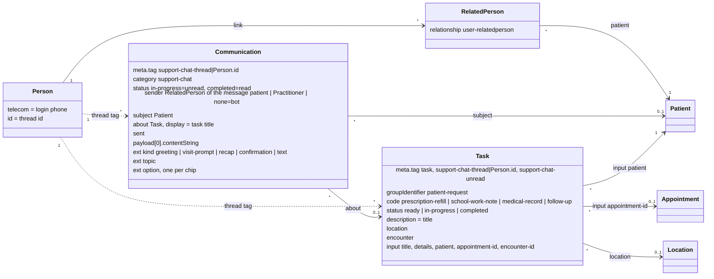
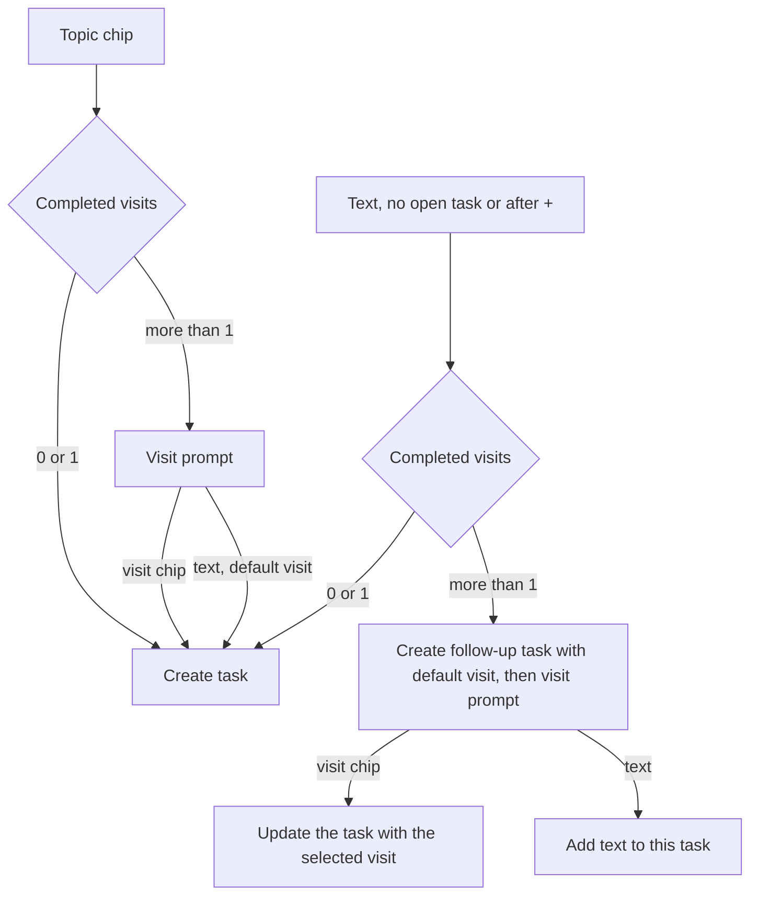

# Patient Requests Through Support Chat

Ticket: OTR-2718 — Patient Portal: let patients submit requests that create tasks in the EHR.

## 1. Goals

- A patient sends a request from the Support Chat widget in the portal.
- Each request creates a task in the EHR. Staff see it in the Tasks list with the other tasks.
- One portal account has one message thread. The thread never closes.
- Staff reply from the task. The patient gets a notification and an unread badge.
- When staff complete a task, they can send a message to the patient.

## 2. Data model

Solid arrow: a FHIR reference. Dashed arrow: no reference, the `Person` id is stored in a `meta.tag`. Numbers show how many resources are on each side.

## 3. Decisions

- **Thread = portal account (`Person`).** The widget shows one thread. A parent can select a visit of any child. Each message and task keeps its own patient. The thread key is a `meta.tag` on `Communication` and `Task`. There is no extra resource.
- **Account = login phone.** In Ottehr a `Person` is found and created by its phone number. In the patient chart, staff can change which login phones (accounts) have access to the patient. When a phone is replaced, the patient is moved to the `Person` of the new phone. The thread does not move: it stays with the old `Person`. Visits stay, because they belong to `Patient`.
- **Known limitation after a login phone change.** Example: Sarah is moved from phone A (mother, `P1`) to phone B (father, `P2`).
  - The mother still sees the old thread, including the messages about Sarah.
  - The father sees the thread of `P2`. New requests about Sarah create tasks in this thread.
  - Old tasks about Sarah stay in the thread of `P1`. A staff reply on such a task appears in the mother's chat. The notification goes by patient: to Sarah's email, or by SMS to phone B if there is no email. The father then opens the chat and does not see the message.
  - If `P1` has no patients left, its chat is not available, and nobody sees replies on the old tasks in the portal.
- **The chat is available only to a logged-in account with at least one patient.** Other users see the old support dialog.
- **Bot messages are stored** without `sender`. The history is complete. Old chips stay visible but disabled.
- **The active prompt is the last message of the thread**, if it is a prompt. There is no separate dialog state. A free-text message disables the chips.
- **Unread** uses `Communication.status`: a new message is `in-progress`, mark-read sets `completed`. Bot messages are stored as `completed`.
- **Unread dot in the EHR** uses the tag `support-chat-unread` on the open task. A patient message sets it. Staff mark-read removes it. The Tasks list and the Tasks tab need no extra data.
- **Task category** `patient-request`, one code per request type. Title: `{Request Type} for {Patient} {Visit Date}`. Unassigned. Location of the selected visit (also the `task-location` tag). In the Tasks list, the existing Category filter shows "Patient Request", and the Location filter shows the task to the staff of that clinic.
- **Visit prompt** is shown after a topic or after free text that starts a request, only if the account has more than one completed visit. With one visit, the bot uses it. The selection is echoed as a recap.
- **Free text with no open task**, or right after a greeting ("+"), creates a `follow-up` task at once. Title: the message text in quotes. Until a visit is selected, the task uses the default visit: the most recent visit of the patient of the last task in the thread, else the most recent visit of the account. A visit selection then updates the task: visit, patient, title, location.
- **Free text instead of a visit selection after a topic** creates the topic task with the default visit; the text becomes the task details.
- **Free text with an open task** is added to that task.
- **Staff messages in the portal** show the task title next to "Support Team". The title is stored in `Communication.about.display`.
- **Staff** are users with a `Practitioner` profile. A staff user always passes `taskId`; a patient user never does.

### Task creation

## 4. Zambdas

All four zambdas are new (`http_auth`). The patient ones are added to the PATIENT role.

| Zambda | Caller | Input | Logic |
|---|---|---|---|
| `get-support-chat` | patient, staff | `taskId?`, `unreadOnly?` | Patient: own thread. Staff: thread of the task. Returns the last 1000 messages, `unreadCount` and `isAvailable`. An empty thread returns a greeting that is not stored. `unreadOnly` reads only unread messages and returns only `unreadCount` and `isAvailable`. |
| `mark-support-chat-read` | patient, staff | `taskId?` | Sets incoming messages to `completed`. Staff: also removes `support-chat-unread` from the thread tasks. |
| `send-support-chat-message` | patient | `new-request`, `select-topic`, `select-visit`, `text` | Runs the bot step. Creates or updates the task. Returns the thread. |
| `reply-support-chat` | staff | `taskId`, `text` | Stores the message (shown to the patient as "Support Team") and notifies the patient. Works also for a completed task. |

## 5. Patient notification

- Email through the existing Generic Outreach template: subject `You have a new message from {Location}`, link to the portal, clinic phone of the location.
- SMS only when the patient has no email.
- Errors in notification do not fail the message.

## 6. Portal (`apps/intake/src/features/support-chat`)

- `useSupportChatStatus` — chat availability and unread badge. Polls every 30 s with `unreadOnly`.
- `useSupportChat` — messages, active prompt, send actions, mark-read when the dialog is open. Polls every 10 s.
- `SupportChatEntry` — the floating "Support Chat" button with the unread dot, and the dialog. Used in both portal footers.
- `SupportChatDialog` — the chat window with the "+" (New Request) button.
- "Contact Support" on the home page opens the chat. The "?" button keeps the old "Need help?" dialog.

## 7. EHR

- Tasks list, row of a Patient Request task: category chip "Patient Request", chat icon with the unread dot, and the quick-action button from the ticket. The button only opens an existing EHR page, so staff can do the request:

| Task code | Button | Opens |
|---|---|---|
| prescription-refill | eRX | eRX of the task visit |
| school-work-note | Plan | Plan of the task visit |
| medical-record | Patient Record | patient chart |
| follow-up | Progress Note | Progress Note of the task visit; no visit → patient chart |

- Tasks tab: orange dot when an open Patient Request task has unread patient messages.
- `SupportChatModal`: full thread history and a reply field.
- Complete: opens the same modal with a "Complete" button and an optional message. The message is sent with `reply-support-chat`, then the task is completed with the existing `useCompleteTask`.

## 8. New and reused

| Area | New | Reused |
|---|---|---|
| FHIR | No new resource types. Tags `support-chat-thread`, `support-chat-unread`. Task category `patient-request`. Communication extensions kind, topic, option. | `Communication` and `Task` with new values. Account resources `Person` → `RelatedPerson` → `Patient` are only read, not changed. |
| Zambdas | 4 zambdas; shared code in `shared/support-chat` | `createTask`; visit search from `get-past-visits` (moved to `shared/visits.ts`); `getPatientsForUser`; Generic Outreach email, `sendSmsForPatient` |
| Portal | `features/support-chat` | Old "Need help?" dialog |
| EHR | `features/support-chat`; Tasks tab dot | Tasks list (new category branch); `useCompleteTask` |
| Shared UI | `ChatMessageList`, `ChatComposer` in `ui-components` | — |
